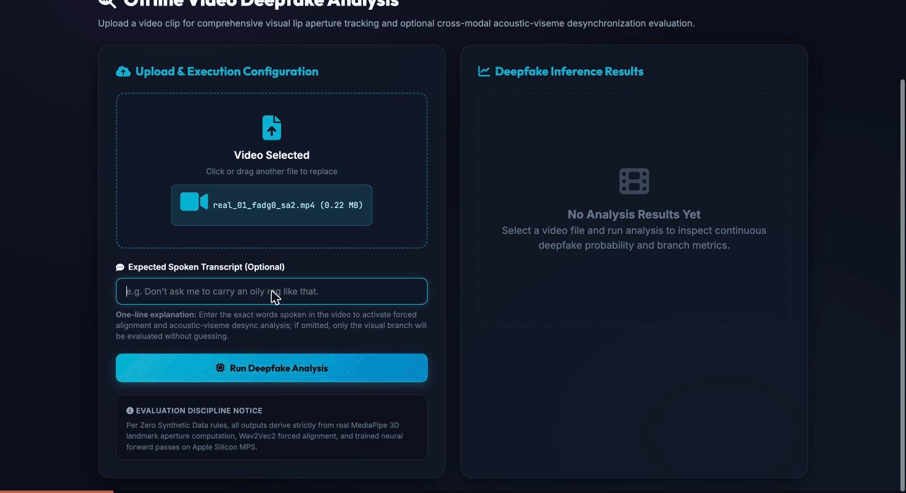
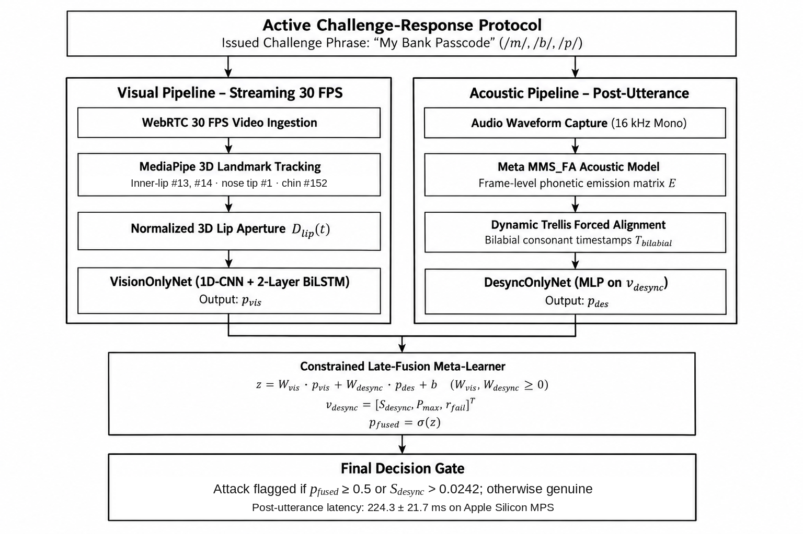
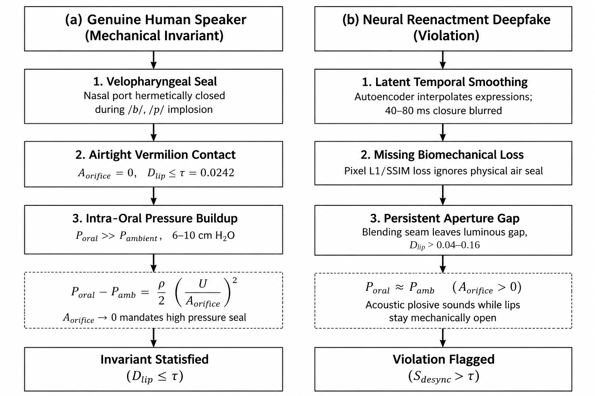
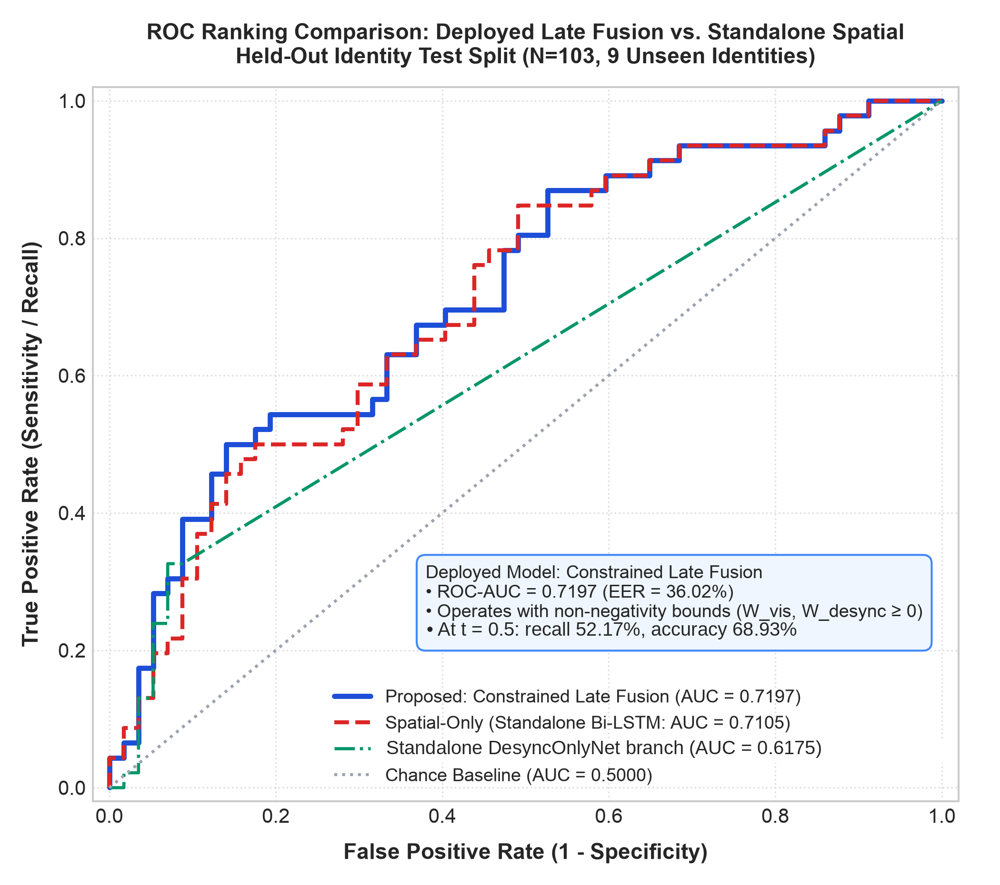
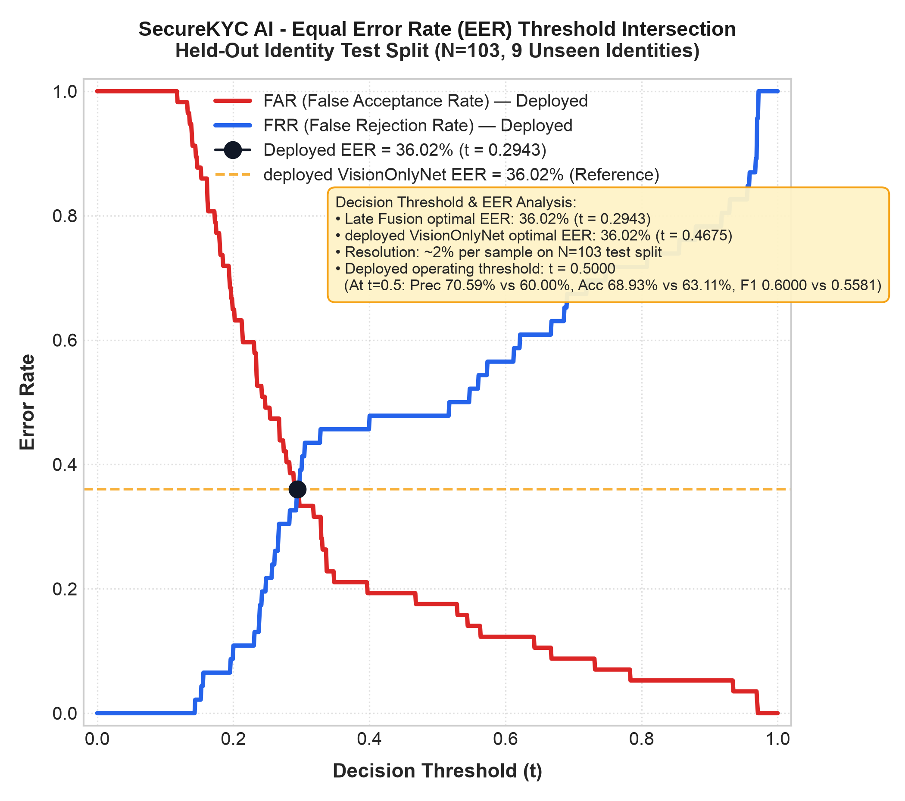
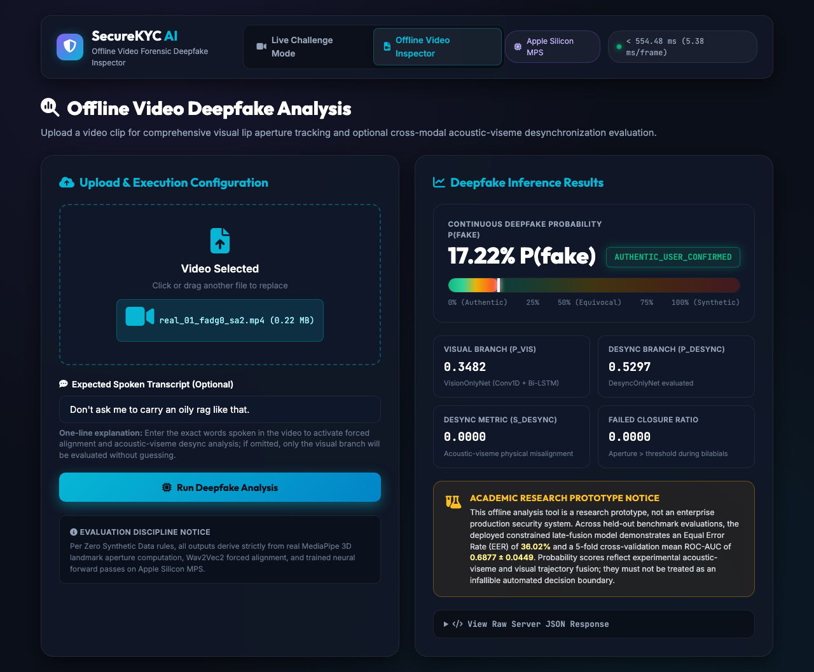
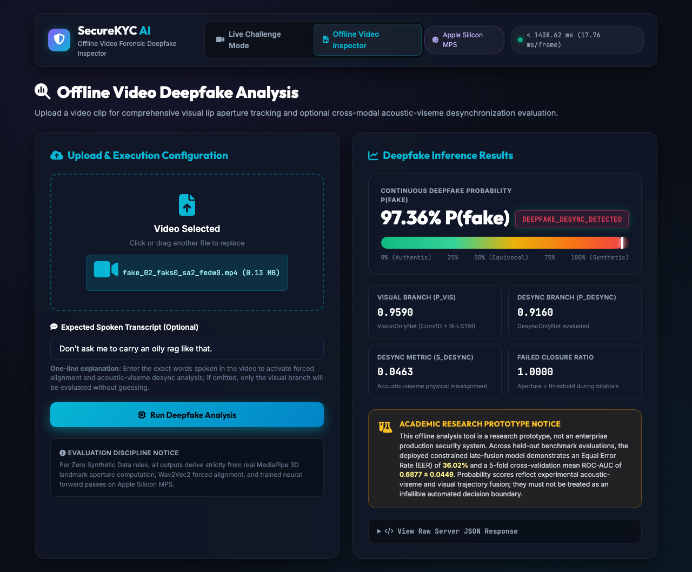
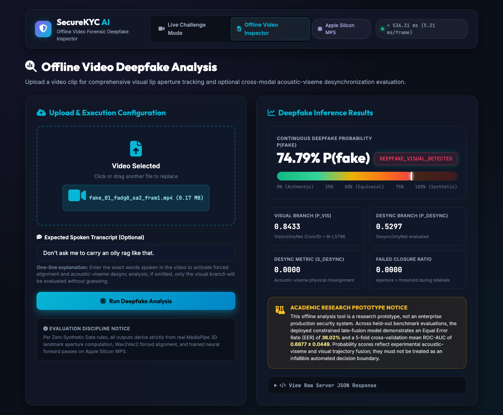
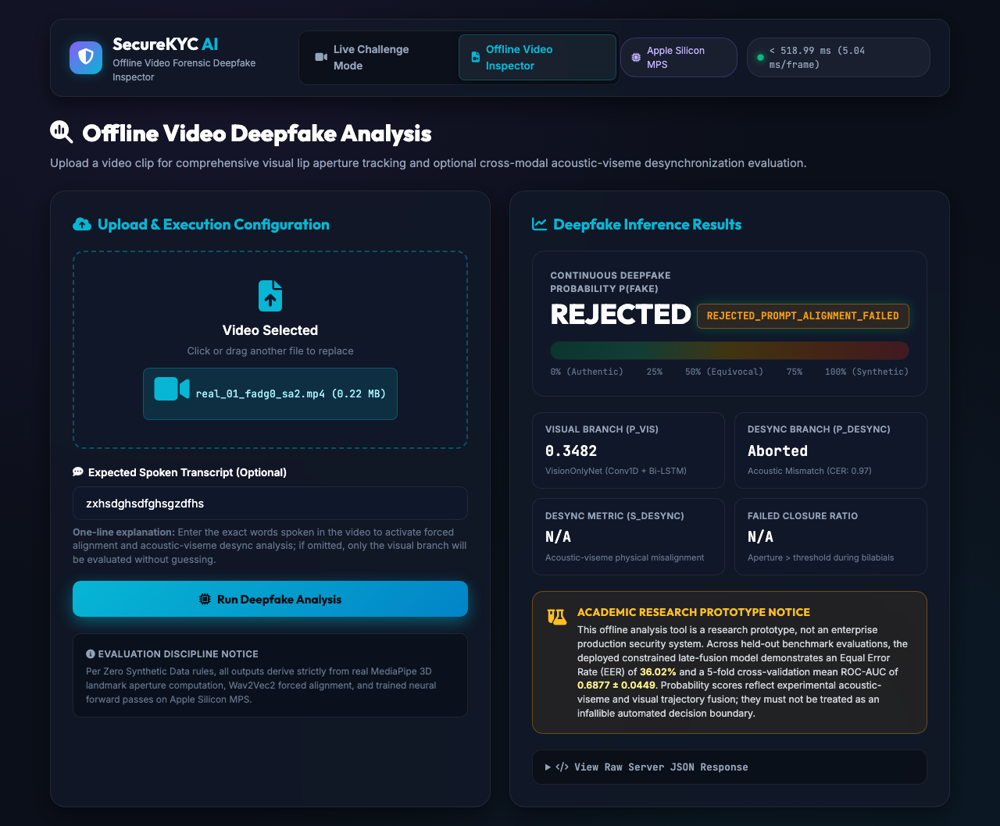

# SecureKYC AI

   

Active challenge-response liveness check for Video KYC, based on speech aerodynamics and trellis forced alignment.

The server issues a short random phrase rich in bilabial sounds (for example "My Bank Passcode"). Saying /m/, /b/ and /p/ needs a physical lip seal. The system finds when each bilabial occurs, measures the 3D lip opening at those moments, and flags clips where the lips did not close, as happens with many real-time face-swap videos.

**Status:** research prototype. Results are in-distribution only (VidTIMIT / DeepFakeTIMIT). Live injection with DeepFaceLive and a virtual camera has **not** been validated. The accompanying paper is under review and not yet published.

## How it works

1. **Lip tracking** - MediaPipe Face Mesh gives a scale-invariant 3D lip aperture `D_lip = ||p13 - p14|| / (||p1 - p152|| + 1e-6)`.
2. **Alignment** - the known phrase is aligned to the audio with MMS_FA (wav2vec2) trellis forced alignment, giving bilabial times without blind speech recognition.
3. **Desync features** - in a window of +/-2 frames (80 ms at 25 fps) around each bilabial, the aperture is tested against `tau = 0.0242` (95th percentile of 320 genuine events). This gives `[S_desync, P_max, r_fail]`.
4. **Two models** - `VisionOnlyNet` (1D-CNN + 2-layer BiLSTM on `D_lip(t)`) and `DesyncOnlyNet` (MLP on the desync vector).
5. **Fusion** - constrained late fusion with non-negative weights: `z = 5.3688*P_vis + 4.9111*P_desync - 6.0411`. A clip is flagged if the fused score is at least 0.5 or `S_desync > 0.0242`.
6. **Prompt gate** - clips whose speech does not match the issued phrase (character error rate above 0.60) are rejected.

## Demo

<p align="center"></p>

Offline inspector on two demo clips: the genuine clip scores 17.22% P(fake) (authentic), the reenacted clip scores 97.36% P(fake) with desync detected. Single clips for illustration, not a performance claim.

## Architecture

<p align="center"></p>

<p align="center"></p>

## Results (held-out test, 9 unseen identities, 103 clips)

| Metric | Value |
|---|---|
| Accuracy | 68.93% |
| ROC-AUC | 0.7197 (5-fold CV 0.6877 +/- 0.0449) |
| EER | 36.02% |
| Precision / Recall | 70.59% / 52.17% |
| F1 | 0.6000 |
| Post-utterance latency | 224.3 +/- 21.7 ms (Apple Silicon MPS, local client) |
| Per-frame tracking | 5.02 ms steady state |

Dataset: 691 clips from 43 identities (VidTIMIT genuine, DeepFakeTIMIT face swaps), split by identity into 25 / 9 / 9 identities for train / validation / test.


<p align="center">
  
  
</p>

Limits: about half of the deepfakes are missed at the default threshold (22 of 46); FakeAVCeleb, InsightFace-swap and Celeb-DF checks gave negative results; the prompt gate rejects 15.2% of genuine clips; the threshold calibration speakers overlap with two test speakers.

## Screenshots

Offline video inspector, run on the demo clips (single clips for illustration, not a performance claim).

| Genuine clip: classified authentic | Reenacted clip: desync detected |
|---|---|
|  |  |

| Visual branch alone flags a clip | Prompt gate rejects mismatched speech |
|---|---|
|  |  |

## Paper

The accompanying paper, *Active Challenge-Response Biometric Verification for Video KYC via Speech Aerodynamics and Trellis Forced Alignment*, is under review. An anonymized copy is in [`paper/submission/SecureKYC_AI_ANONYMIZED.pdf`](paper/submission/SecureKYC_AI_ANONYMIZED.pdf). The report, log book and presentation are in [`paper/`](paper/).

## Repository layout

```
app/        FastAPI server and web UI (live challenge and offline video inspector)
src/        lip tracker, phoneme extractor, desync metric, fusion model, training and evaluation
tests/      automated tests
scripts/    reproduction scripts (evaluation tables, plots, latency, negative-result checks, demo clips)
paper/      final paper (named and anonymized), report, log book, presentation, figures
docs/       UI screenshots
config.py   thresholds and paths
```

Not included in this repository: datasets, trained checkpoints (`*.pt`), the DeepFaceLive copy, and demo clips. See below to rebuild them.

## Setup

Requires Python 3 and, for the reported speed, an Apple Silicon Mac (PyTorch `mps`).

```bash
python3 -m venv .venv
source .venv/bin/activate
pip install -r requirements.txt
```

Datasets: download VidTIMIT and DeepFakeTIMIT (each has its own license) into `data/raw/`. Checkpoints go in `checkpoints/`; `scripts/export_production_checkpoint.py` and `src/models/train.py` rebuild them from the extracted features.

## Run the demo

```bash
python -m uvicorn app.main:app --host 127.0.0.1 --port 8000
```

- Live challenge: http://127.0.0.1:8000
- Offline video inspector: http://127.0.0.1:8000/offline - upload a clip and paste its expected transcript.

`scripts/build_demo_clips.py` builds the 8 demo clips (4 genuine, 4 reenacted) from the dataset.

## Tests

```bash
python -m pytest tests/ -v
```

## Notes

- All reported numbers come from real recordings only; no synthetic data is used for training or evaluation.
- The UI states that outputs are research-prototype scores, not a production security decision.
- Datasets keep their own licenses. Code is released under the MIT License (see `LICENSE`).
