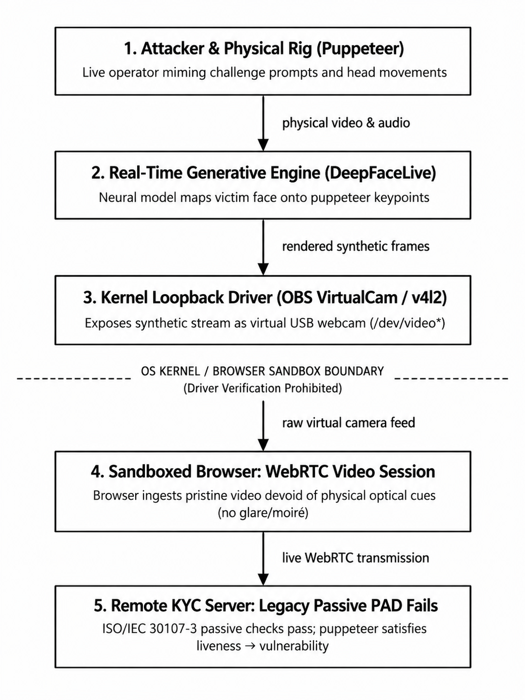
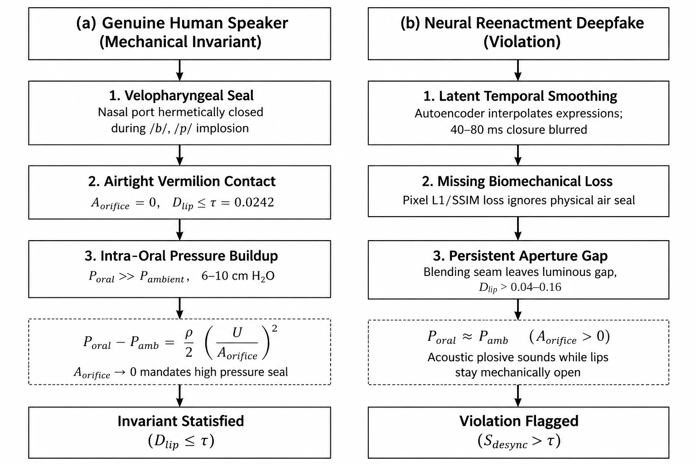
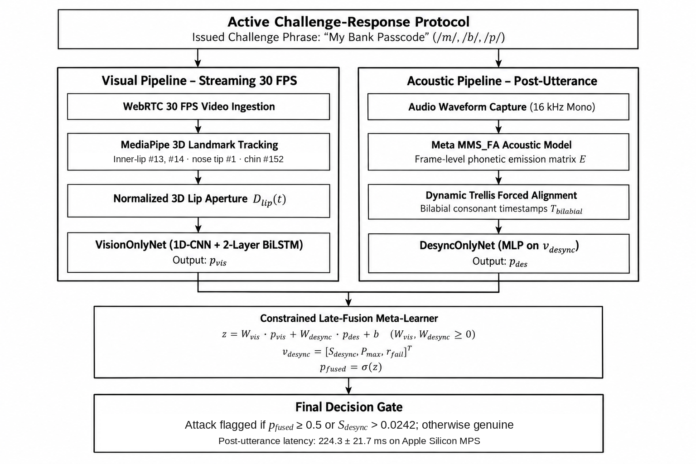
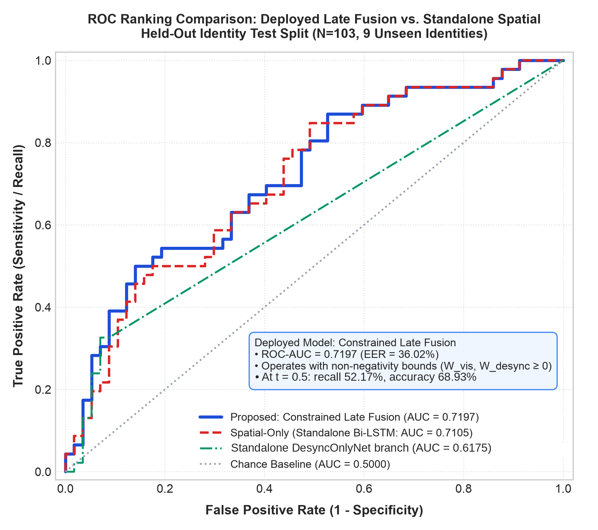
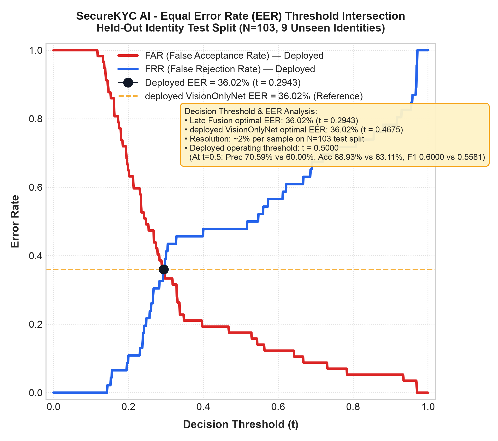
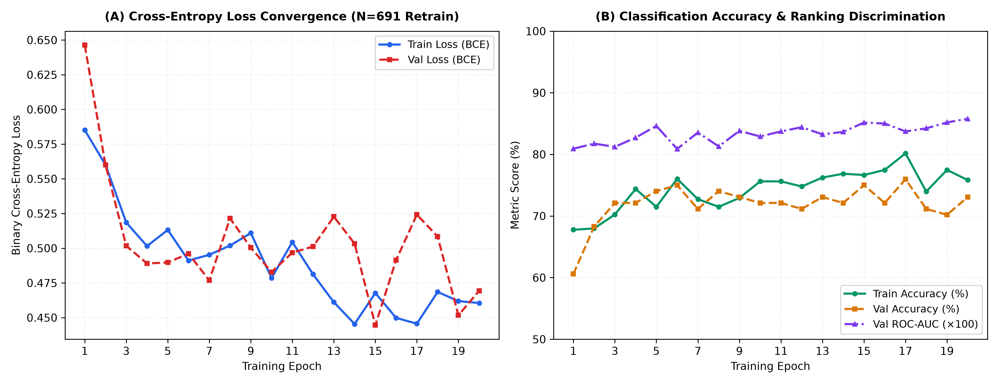

# Active Challenge-Response Biometric Verification for Video KYC via Speech Aerodynamics and Trellis Forced Alignment

**Jatin Dhawad**  
*Department of Computer Engineering*  
*School of Technology Management & Engineering (STME)*  
*SVKM's NMIMS, Indore, India*  
jatin.dhawad652@nmims.in  

**Param Rawal**  
*Department of Computer Engineering*  
*School of Technology Management & Engineering (STME)*  
*SVKM's NMIMS, Indore, India*  
param.rawal480@nmims.in  

---

### Abstract
Onboarding with remote Video KYC is vulnerable to synthetic identity injection, because virtual cameras and real-time face re-enactment can produce clean frames that may escape passive attack detection. In this paper we introduce SecureKYC AI, an active challenge-response approach based on one physical property of human speech: articulating bilabial consonants (/m/, /b/, /p/) requires the lips to be closed (P_oral >> P_ambient). The server delivers a randomly generated challenge phrase. MediaPipe Face Mesh tracks lip movement during articulation of the phrase, wav2vec2 forced alignment (MMS_FA) marks the moment of each bilabial occurrence, and a scale-independent 3D lip aperture is measured at these timestamps. On N=691 audio-visual clips (43 disjoint subjects; train/validation/test = 25/9/9 identities and 484/104/103 clips), the deployed constrained late-fusion meta-learner achieves 68.93% accuracy, 0.7197 test ROC-AUC (5-fold CV: 0.6877 ± 0.0449), 36.02% EER, and 0.6000 F1-score. At the default 0.5 operating point, late fusion produced 10 false alarms on the 57 genuine test clips versus 16 for the standalone vision branch (paired bootstrap 95% CI for the difference [0, 12]; the interval reaches zero), with identical recall (52.17%) and higher precision (70.59% vs 60.00%); at the equal-error point the two models are identical. Across all 691 clips, the closure-failure ratio averages 4.5% for authentic and 41.6% for reenacted clips (Cohen's d of S_desync: 0.66 per clip, 1.10 per subject). The average processing time for each frame offline at steady-state is $5.02\text{ ms}$ ($14.05\text{ ms}$ at the start-up phase, according to nine video demonstrations). This research focuses only on in-distribution benchmark tests, which require further validation in practice using multi-camera test scenarios.

**Index Terms**—Video KYC, Deepfake Detection, Presentation Attack Detection, Speech Aerodynamics, Forced Alignment, Bilabial Closure, Active Challenge-Response, Multimodal Biometrics.

---

## I. INTRODUCTION

Onboarding of remote users in accordance with RBI Master Directions on KYC and Europe's AMLD5 and eIDAS rules requires a WebRTC video call session. Recent work on facial biometric security has proposed multimodal deep learning with cryptographic protection to guard facial authentication against spoofing [22]. The paradigm assumes a live applicant positioned in front of an optical camera sensor. However, this assumption is negated by modern real-time generative models. Traditional presentation attacks, which include printed images, silicone masks, or screen playback, required traversal of the optical path. In the case of today's attacks, synthetic frames can be injected directly into the input stream [1], [2].

Optical liveness detection techniques consider imaging artifacts such as frequency-domain artifacts [3], up-convolution effects [4], pose drifts [5], and rPPG heartbeats [6], [7]. Injection attacks remove the optical path from the threat model. Loopback drivers like OBS Virtual Camera, ManyCam, and v4l2loopback for Linux enable arbitrary image buffers to be used as input device streams. A browser sandbox has no way to check driver signatures, so the distant verifier gets a clean pixel image without any glare, moire effect, or distortion effect that usually happens in physical capturing process.

The real-time puppetry makes the injection interactive. The attacker sits at a webcam and speaks, and a reenactment tool such as DeepFaceLive (built on DeepFaceLab) tracks their facial keypoints frame by frame and renders the victim's face over those movements [8]. Passive presentation attack detection (PAD) in the sense of ISO/IEC 30107-3 does not stop this. These blink, smile, and yaw triggers fail since the attacker carries out the trigger, and the neural mask simulates it with sub-frame latency. Behavioral biometrics, including continuous person authentication, have been surveyed for identity verification in domains such as banking and finance [23]. This entire process is shown in Fig. 1.

*Fig. 1.  Video KYC – virtual camera injection threat model. The attack consists of injecting a fake video during the video call to evade the optical liveness check.*

### A. Prior Art: The Limitations of Visual Challenge Cascades

Passive mechanisms are not effective for this, and therefore, a move toward the active challenge-response mechanisms is called for. The most relevant previous mechanism is GOTCHA by Mittal et al. (2024), presented at IEEE EuroS&P [9]. GOTCHA uses physical challenges; it involves either covering the face using the hand, standing up, or moving the head so as to change the yaw angle. Generally, the principle behind this is that generators will fail to accomplish this because of hand occlusion and the change in yaw angle. The mechanism obtains an automatic AUC of 80.1% (88.6% human AUC) [9].

Adapting this mechanism to a Video KYC setting leads to three major issues:

1) User effort. It will be challenging to ask the user to perform actions such as covering their face with a hand or standing up during a formal onboarding identity call.
2) Time consumption. Physical challenges take time, which contradicts the requirement of a sub-second reaction time after the utterance.
3) No voice is used. The GOTCHA system works solely with the video feed and does not consider either the voice input or the actual physical process that produces the voice.

### B. Contributions of This Work

SecureKYC AI is a liveness-based approach, which leverages speech generation physical features. There are five main points that could be highlighted:

1) Live test using aerodynamics. By definition, liveness relies on aerodynamics of speech (P_oral >> P_ambient). The presence of bilabial phonemes /m/, /b/, and /p/ demands closure of the lips, which is usually absent in face-swapped videos from the dataset.
2) Dynamic Trellis Forced Alignment without Blind Automatic Speech Recognition (ASR). The challenge phrase is selected by the server from a list of predefined phrases containing bilabial phonemes (e.g., "My Bank Passcode"), thereby allowing the ground truth transcription of the utterance to be obtained even prior to saying it. MMS_FA trellis alignment then extracts the timing of every bilabial articulation without any open-vocabulary speech recognition.
3) Dual-Budget Real-Time Architecture. We split the computation into a streaming visual tracking pass (the offline endpoint's amortized per-frame time, covering video decoding, landmark tracking, vision-branch inference and the audio check, was 5.02 ms in steady state over 9 demo clips and 14.05 ms on the first call) and a post-utterance acoustic alignment pass, giving a client-side verification time of 224.3 ± 21.7 ms on Apple Silicon MPS (local in-process client).  
4) Constrained Late-Fusion Meta-Learner. We found feature scale disparity and gradient interference in early-fusion networks (Section V-B), so we train the two branches separately and combine them with a non-negatively constrained stacking meta-learner (W_vis ≥ 0, W_desync ≥ 0). The constraint prevented the weight sign inversion we saw in one cross-validation fold.
5) Strict Empirical Verification. Adhering strictly to zero-synthetic-data and zero-identity-leakage protocols, we evaluate the system on N=691 clips across 43 disjoint subjects (25 train, 9 val, 9 test identities; 484/104/103 clips), validating an operating accuracy of 68.93% and 0.7197 test ROC-AUC.

---

## II. AERODYNAMIC & BIOMECHANICAL FOUNDATIONS

### A. Fundamentals of Bilabial Speech Aerodynamics

Human speech production is governed by the continuous mechanical manipulation of pulmonary airflow across the vocal tract [10], [11]. Consonants are classified by their manner and place of articulation. Among English phonemes, the bilabial consonants—the voiced bilabial nasal /m/, voiced bilabial stop /b/, and voiceless bilabial stop /p/—possess a unique biomechanical invariant: complete, airtight mechanical coaptation of the vermilion borders of the upper lip (labium superius) and lower lip (labium inferius) [11]. Fig. 2 compares genuine and reenacted bilabial production.

*Fig. 2.  Aerodynamic and biomechanical comparison of bilabial consonant production (/m/, /b/, /p/) between genuine human speakers and neural reenactment deepfakes.*

During the closure phase (implosion) of /b/ and /p/, the velopharyngeal port closes and seals off the nasal cavity. Pulmonary airflow continues into the closed oral cavity, so intra-oral pressure (P_oral) rises quickly above ambient atmospheric pressure (P_ambient). According to Bernoulli's acoustic volume velocity relation [10]:

$$P_{\text{oral}} - P_{\text{ambient}} = \frac{\rho}{2} \cdot \left(\frac{U_{\text{air}}}{A_{\text{orifice}}}\right)^2 \tag{1}$$

In this relation $\rho$ is air density, $U_{\text{air}}$ is the acoustic volume velocity, and $A_{\text{orifice}}$ is the cross-sectional area of the lip opening. Equation (1) holds only while the orifice is open. A burst release needs the lips to seal first ($A_{\text{orifice}} \to 0$): the seal stops the airflow through them, so $P_{\text{oral}}$ builds up behind the closure to a peak of about 6 to 10 cm $\text{H}_2\text{O}$ above atmospheric pressure [11]. For /m/, the velopharyngeal port is open, but the lips stay sealed, so the sound leaves only through the nose.

### B. Why Generative Face-Swaps Fail at Bilabial Closure

Neural face reenactment and face-swap models (autoencoders, GANs, latent diffusion) have three built-in limits that make them likely to get bilabial closure wrong:

1) Latent averaging. These models interpolate expressions in a low-dimensional latent space. Going from an open vowel to a closed bilabial takes only 40 to 80 ms (1 to 3 frames at 30 FPS). Temporal smoothing and the encoder-decoder bottleneck blur such fast movement, so the synthetic lips can stay partly open [12], [13].  
2) No physical constraint. Common deepfake losses (perceptual L1/L2, multi-scale SSIM, PatchGAN adversarial loss) reward pixel similarity. None of them penalizes a missing air seal [12].  
3) Blending artifacts. The mouth interior is full of fine detail (teeth, tongue, shadow), and generators often leave blending seams along the lip edge, which can leave a bright gap between the upper and lower lip [14].

Fig. 3 demonstrates the difference. Real speakers consistently produce normalized lip aperture values lower than $\tau = 0.0242$ for bilabials. For the swapped samples shown in the figure, $D_{\text{lip}}$ at the bilabial centre ($t = 0$) varies between 0.04 and 0.16, which is higher than $\tau$ in all six traces, although one trace reaches about $\tau$ at +40 and +80 ms.

*Fig. 3.  Normalized 3D lip aperture D_lip(t) for real VidTIMIT speakers (Panel A: fadg0, fgjd0) and DeepFakeTIMIT swaps (Panel B: faks0/fedw0, msjs1/mrgg0), plotted with scripts/plot_bilabial_window_trajectories.py. Real speakers drop below τ = 0.0242 at the forced-alignment bilabial times T_bilabial. In the swapped clips the mouth mostly stays open.*

---

## III. SECUREKYC AI SYSTEM ARCHITECTURE

The overall architecture of the system is shown in Fig. 4. SecureKYC AI operates on two separate streams: a visual stream that runs in real time as the speaker talks, and an acoustic alignment procedure that runs after the utterance ends.

*Fig. 4.  Overview of the SecureKYC AI system. Visual tracking runs during streaming, and audio alignment and scoring run after the utterance.*

### A. Real-Time 3D Lip Aperture Metric

The lip aperture is computed independently of camera distance by tracking 3D facial landmarks with the MediaPipe Face Mesh [15] library, with landmark refinement enabled and the face-detection confidence threshold set to 0.5. Facial analysis in the wild, where head movement, face deformation, and illumination changes degrade features, has been studied with residual networks [24]. Let p_i = (x_i, y_i, z_i) be the coordinates of the i-th landmark. If face detection fails for several consecutive frames, the missing apertures are linearly interpolated, provided the gap is no longer than three frames. The interpolated apertures are used by VisionOnlyNet, while the desynchronization score takes into account only the frames where the face was detected. Clips with longer gaps are considered to have an unreliable facial track.

The normalized lip aperture $D_{\text{lip}}(t)$ in video frame $t$ is defined as the distance between the inner upper and lower lip points divided by the face height (the distance between the nose tip and the chin):

$$D_{\text{lip}}(t) = \frac{\|p_{13}(t) - p_{14}(t)\|_2}{\|p_1(t) - p_{152}(t)\|_2 + 10^{-6}} \tag{2}$$

Here p₁₃ is the center of the inner upper lip, p₁₄ is the center of the inner lower lip, p₁ is the nose tip, and p₁₅₂ is the chin landmark, which means that the denominator is equal to the face height. The constant 10⁻⁶ prevents division by zero. Normalizing by face height makes D_lip(t) almost independent of camera distance and downsampling.

### B. Trellis Forced Alignment via MMS_FA

Most audio-visual sync methods transcribe the speech first, and recognition errors on short, noisy recordings then propagate into the alignment. In SecureKYC AI the server generates the challenge prompt, so the intended transcript is known in advance. Before any alignment is attempted, a separate character-error-rate (CER) check (Section V-F) using a wav2vec2 CTC recognizer rejects audio that does not match the issued prompt.

Let $\mathbf{a} = [a_1, a_2, \dots, a_T]$ denote the resampled 16 kHz audio waveform. We pass $\mathbf{a}$ through the pre-trained Meta MMS_FA wav2vec2 acoustic model [16], [17] to obtain frame-level emission log-probabilities $\mathbf{E} \in \mathbb{R}^{T_{\text{audio}} \times |V|}$, where $|V|$ is the model's character vocabulary (26 lowercase letters, an apostrophe, a word-boundary token and the CTC blank; 29 labels in total).

We build an alignment trellis $\alpha(t, j)$ giving the log-probability of aligning acoustic frame $t$ to character token $j$ of the known phrase. Because the tokens are letters, we treat the tokens m, b and p as bilabial events, which is reliable only because the challenge phrases come from a controlled pool:

$$\alpha(t, j) = \max\left(\alpha(t-1, j), \alpha(t-1, j-1)\right) + E(t, c_j) \tag{3}$$

The start and end times of each bilabial sound $k$ in the set $\{/m/, /b/, /p/\}$ can be expressed as:

$$T_{\text{bilabial}}^{(k)} = \left[t_{\text{start}}^{(k)},\; t_{\text{end}}^{(k)}\right] \tag{4}$$

### C. Cross-Modal Desynchronization Formulation

The frame closest to the center of the time-aligned interval of each bilabial closure $k$, among the frames where a face was detected, is selected and denoted $f_{\text{mid}}^{(k)}$. As anticipatory coarticulation enables lip closure to happen within a few tens of milliseconds before or after the burst release [11], a two-frame window around $f_{\text{mid}}^{(k)}$ is employed (±80 ms at the 25 fps of VidTIMIT):

$$W_k = \left[f_{\text{mid}}^{(k)} - 2,\; f_{\text{mid}}^{(k)} + 2\right] \tag{5}$$

Within this window, we check whether the speaker's normalized aperture falls below the physical closure threshold $\tau = 0.0242$:

$$P_{\text{sync}}^{(k)} = \max\left(0, \min_{t \in W_k} D_{\text{lip}}(t) - \tau\right) \tag{6}$$

When there is no detected face in any frame within the window, the minimum aperture of the event is set to 1.0, meaning that the closure is considered a failure. From all $K$ bilabial events in the utterance, we construct a three-dimensional cross-modal desynchronization vector $\mathbf{v}_{\text{desync}} \in \mathbb{R}^3$:

$$\mathbf{v}_{\text{desync}} = \left[S_{\text{desync}},\; P_{\max},\; r_{\text{fail}}\right]^T \tag{7}$$

where $S_{\text{desync}} = \frac{1}{K} \sum_{k=1}^K P_{\text{sync}}^{(k)}$, $P_{\max} = \max_k P_{\text{sync}}^{(k)}$, and $r_{\text{fail}} = \frac{1}{K} \sum_{k=1}^K \mathbb{I}\left(P_{\text{sync}}^{(k)} > 0\right)$.

### D. Constrained Late-Fusion Meta-Learner

In our early experiments with a joint multi-task network (MultimodalKYCFusionNet), concatenating $\mathbf{v}_{\text{desync}}$ with the visual embeddings produced destructive gradient interference. We therefore split the architecture into two independently trained base classifiers:

1) Visual Base Network (VisionOnlyNet): A 1D convolutional feature extractor coupled to a 2-layer Bidirectional LSTM (hidden dimension 64) that processes the temporal aperture trajectory $D_{\text{lip}} \in \mathbb{R}^{T \times 1}$, outputting posterior probability $P_{\text{vis}} \in [0, 1]$.  
2) Acoustic-Phonemic Base Network (DesyncOnlyNet): A multi-layer perceptron processing $\mathbf{v}_{\text{desync}}$, outputting posterior probability $P_{\text{desync}} \in [0, 1]$.

We combine the base predictions via a constrained late-fusion meta-learner:

$$z = W_{\text{vis}} \cdot P_{\text{vis}} + W_{\text{desync}} \cdot P_{\text{desync}} + b, \quad P_{\text{fused}} = \sigma(z) \tag{8}$$

Crucially, we enforce non-negativity constraints during optimization:

$$\min_{W_{\text{vis}}, W_{\text{desync}}, b} \mathcal{L}_{\text{BCE}}(y, \sigma(z)) + \frac{\lambda}{2}\left(W_{\text{vis}}^2 + W_{\text{desync}}^2\right) \quad \text{s.t.} \quad W_{\text{vis}} \ge 0, \; W_{\text{desync}} \ge 0 \tag{9}$$

solved with L-BFGS-B. Constraining both weights to be non-negative stops either branch from flipping sign on outlier speakers. It does not guarantee that fusion matches the better single branch (Table II, Fold 1).

---

## IV. EXPERIMENTAL SETUP & PROTOCOL

### A. Zero-Synthetic-Data & Hardware Target

This study uses no synthetic data and no simulated distributions. Every metric, ROC curve and latency figure we computed comes from the real signal-processing pipeline and live PyTorch forward passes; the exceptions are the GOTCHA AUC quoted from the literature and the dagger-marked Sep 4 ablation rows in Table I. Training and latency profiling were done using an Apple Silicon Mac, with Metal Performance Shaders (torch.device("mps")).

### B. Identity-Disjoint Benchmark Dataset

With a random split at clip level, an individual can appear in both training and test splits, resulting in the problem of identity leakage [2], [13]. Identity leakage makes the classifier favor facial appearance over manipulation cues. The experiments employ N=691 video-audio clips: N=275 real videos from VidTIMIT [1] and N=416 fake videos generated by neural autoencoders in DeepFakeTIMIT [1].

Disjoint identity splits are made using split_dataset_by_identity(). This function constructs a graph over the dataset and does a connected component analysis to split the 43 identities into disjoint subsets:

• Training set: 25 identities (N=484 clips: 172 real and 312 fake).  
• Validation Set: 9 identities (N=104 clips: 46 real, 58 fake).  
• Held-Out Test Set: 9 completely unseen identities (N=103 clips: 57 real, 46 fake; Train ∩ Test = ∅).

The 9 held-out test identities are: fadg0, fcmr0, fpkt0, fram1, mbdg0, mbjk0, mreb0, mrjo0, and mstk0.

### C. Physical Calibration of Closure Threshold

The closure detection threshold τ is derived from real VidTIMIT data as follows: N=320 bilabial closures by 15 speakers, calculated using src/metrics/calibrate_threshold.py and stored in data/processed/calibration_events_breakdown.json. The empirical distribution of D_lip at these events was:

• Minimum D_lip: 0.0026 | 10th Percentile: 0.0041 | 25th Percentile: 0.0059  
• Median: 0.0077 | 75th Percentile: 0.0103 | 90th Percentile: 0.0131  
• 95th Percentile (Calibrated Threshold): 0.0241 (~0.0242 in config.py)  
• 99th Percentile: 0.0787 | Maximum D_lip: 0.1280 | Mean ± Std: 0.0103 ± 0.0125

According to definition, 95.0% of the 320 calibration measurements are ≤ τ = 0.0242. Across all 691 clips, the average per-clip closure-failure ratio is 4.49% for authentic clips and 41.63% for reenacted clips. The effect size of S_desync between reenacted and authentic clips is Cohen's d = 0.66 per clip and 1.10 per subject (42 authentic and 32 reenacted subjects). Note that the 15 calibration speakers include two of the nine test identities (fadg0 and fcmr0; 42 of the 320 events), so τ is not fully independent of the test split.

#### TABLE I: COMPARISON OF PERFORMANCE FOR MODEL ABLATIONS (TEST SET WITH HELD-OUT IDENTITY, N=103)

| Model Version / Feature Options | Accuracy (%) | APCER (%) | BPCER (%) | Precision (%) | Recall (%) | F1-Score | ROC-AUC | Equal Error Rate (EER) |
| --- | --- | --- | --- | --- | --- | --- | --- | --- |
| VisionOnlyNet (Spatial Standalone) | 63.11% | 47.83% | 28.07% | 60.00% | 52.17% | 0.5581 | 0.7105 | 36.02% |
| DesyncOnlyNet (Passive Standalone)* | 44.66% | 0.00% | 100.00% | 44.66% | 100.00% | 0.6174 | 0.6175 | 38.08% |
| Proposed Production: Constrained Late Fusion (Official Deployed) | 68.93% | 47.83% | 17.54% | 70.59% | 52.17% | 0.6000 | 0.7197 | 36.02% |
| Deployed Pipeline Rule: Constrained Late Fusion OR S_desync > 0.0242 | 68.93% | 47.83% | 17.54% | 70.59% | 52.17% | 0.6000 | — | — |
| Spatial-Only (Zero out desync_vec)† | 61.17% | — | — | 68.75% | 23.91% | 0.3548 | 0.6182 | — |
| Passive-Only (Zero out lip_seq)† | 55.34% | — | — | 0.00% | 0.00% | 0.0000 | 0.6232 | — |
| Baseline Early Fusion: MultimodalKYCFusionNet (Raw Concat)† | 65.05% | — | — | 67.86% | 41.30% | 0.5135 | 0.6423 | — |
| Expected Generalization: Constrained Late Fusion (5-Fold CV Mean) | — | — | — | — | — | — | 0.6877 ± 0.0449 | 36.00 ± 2.98% |
| Literature Benchmark: GOTCHA (Mittal et al., 2024) [9]* | — | — | — | — | — | — | 0.8010* | — |

*Model Rows vs. Deployed Pipeline Rule: The model rows are scored against a threshold of 0.5, except for ROC-AUC and EER, where all thresholds are considered. The Deployed Pipeline Rule adds the desynchronization override implemented in app/main.py (fused >= 0.5 OR S_desync > 0.0242). On the held-out test split (N=103), exactly 0 test clips satisfied S_desync > 0.0242 and p_fused < 0.5 (all 4 clips with S_desync > 0.0242 already had p_fused ≥ 0.5); thus, the physical desynchronization override changed no test verdict on this split. At threshold 0.5, APCER (47.83%, 22/46) is identical for both VisionOnlyNet and Constrained Late Fusion. BPCER is 28.07% (16/57) for VisionOnlyNet versus 17.54% (10/57) for Constrained Late Fusion (paired bootstrap 95% CI for the difference [0, 12] false alarms; the interval reaches zero). Standalone DesyncOnlyNet collapses to predicting every clip as an attack (BPCER 100.00%, 57/57; APCER 0.00%, 0/46).  
*Note on GOTCHA: Literature-reported automated AUC in [9] across multi-stage visual cascades (hand occlusions, head turns). Evaluated on live streams in [9] and not trained or tested on this project's dataset; included strictly as a literature reference for active challenge-response protocols.  
†Logged ablation values from the Sep 4 training run. The standalone Bi-LSTM logged in that run reached AUC 0.7040 (Acc 64.08%, Prec 76.47%, Rec 28.26%, F1 0.4127); it came from a different training run than the production VisionOnlyNet baseline (AUC 0.7105). Neither EER nor operating thresholds are reported for the zero-masked feature ablations.

---

## V. EMPIRICAL RESULTS & DISCUSSION

### A. Model Ablation Analysis

As Table I shows, at the default threshold (t=0.50) VisionOnlyNet and Constrained Late Fusion have identical recall (52.17%, 24 of 46 deepfakes detected). Constrained Late Fusion reduces false alarms from 16 to 10 at the default 0.5 operating point; at the equal-error point the two models are identical. This raises precision from 60.00% to 70.59%, accuracy from 63.11% to 68.93%, and F1 from 0.5581 to 0.6000 (paired bootstrap on the difference in false alarms over the 57 real clips yields 95% CI [0, 12]). Both models reach an EER of 36.02% (thresholds t = 0.4675 and t = 0.2943, both giving a false acceptance rate (FAR) of 35.09% and a false rejection rate (FRR) of 36.96%). Fig. 5 shows the ROC curves and Fig. 6 shows the FAR and FRR curves behind these numbers. Ranking discrimination (AUC 0.7197 vs. 0.7105; paired bootstrap difference +0.0092, 95% CI [-0.0265, +0.0425], which spans zero) is comparable and within run-to-run sampling variation. The 5-fold CV mean AUC for late fusion (0.6877 ± 0.0449) is lower than standalone (0.7104). With 57 genuine and 46 deepfake test clips, each sample misclassification shifts error rates by about 2%, setting the discrete resolution of the test partition.

### B. Feature Scale Disparity and Late Fusion

The most important negative finding of this work is that early multimodal concatenation failed. In MultimodalKYCFusionNet, concatenating $\mathbf{v}_{\text{desync}}$ with the visual embeddings dropped test ROC-AUC from 0.7105 (Spatial Standalone) to 0.6423. Fig. 7 shows the training curves of this model. The decoupled sensitivity analysis shows that the underlying cause is as follows:

• S_desync ≈ 10⁻², whereas r_fail ≈ 10⁰.  
• The linear projection weights have comparable values (|W| ≈ 0.05), and therefore the pre-activation of r_fail becomes 60–100 times greater than that of S_desync, which effectively suppresses the contribution of the continuous metric penalty.
• When splitting modality to two base classifiers and then using non-negative constraint for late fusion (W_vis = 5.3688, W_desync = 4.9111, b = -6.0411), gradient interference is avoided.

#### TABLE II: 5-FOLD IDENTITY-GROUPED STABILITY OF THE META-LEARNER (34 TRAIN+VAL IDENTITIES, 588 CLIPS; AUC AND EER ON THE FIXED TEST SET, N=103)

| Fold | Val IDs | Val N | W_vis | W_desync | Intercept | Spatial Standalone AUC | Constrained Late AUC | Δ vs. Spatial | EER (%) | Unconstrained Late AUC |
| :---: | :---: | :---: | :---: | :---: | :---: | :---: | :---: | :---: | :---: | :---: |
| 1 | 7 | 119 | 0.0000 | 12.5037 | -6.0913 | 0.7941 | 0.6175 | -0.1766 | 38.08% | 0.4613 (Crash) |
| 2 | 7 | 113 | 4.5942 | 9.7904 | -8.1186 | 0.7540 | 0.7548 | +0.0008 | 30.13% | 0.7548 |
| 3 | 7 | 125 | 2.6426 | 6.6113 | -5.0020 | 0.6430 | 0.6758 | +0.0328 | 37.99% | 0.6758 |
| 4 | 7 | 108 | 6.2062 | 4.3486 | -5.7960 | 0.6613 | 0.6812 | +0.0198 | 36.90% | 0.6812 |
| 5 | 6 | 123 | 4.2882 | 7.8638 | -6.9213 | 0.6995 | 0.7094 | +0.0099 | 36.90% | 0.7094 |
| Mean | — | — | 3.5463 | 8.2236 | -6.3858 | 0.7104 | 0.6877 | -0.0227 | 36.00% | 0.6565 |
| Std | — | — | 2.1032 | 2.7755 | 1.0620 | 0.0565 | 0.0449 | 0.0777 | 2.98% | 0.1121 |

As can be seen from Table II, the non-negativity constraint is important. For instance, in the first fold, the unconstrained model gives a negative value of W_vis (-0.0111), while the test AUC is 0.4613, that is, below chance. With the non-negativity constraint, W_vis was clipped to 0.0000 and the model reverted to the desynchronization baseline (0.6175). Nevertheless, in Fold 1 the constrained model (0.6175) still performed worse than the standalone spatial branch (0.7941), which indicates that the constraint prevents inversion of the branches but does not ensure parity. It is critical to observe how the folds are constructed: for each fold, the base models are trained again, while the meta-learner is trained on the held-out fold (Val N). AUC and EER are then evaluated on the same fixed test split. The variability thus reflects differences in training sets rather than independent test sets.

 
*Fig. 5. Receiver Operating Characteristic (ROC) curves on held-out test split (N=103). Deployed VisionOnlyNet achieves AUC = 0.7105, Deployed Constrained Late Fusion achieves AUC = 0.7197, and the green curve represents the standalone DesyncOnlyNet branch (AUC = 0.6175).*  
*Fig. 6. FAR and FRR curves. Deployed VisionOnlyNet and Constrained Late Fusion both have EER = 36.02% (resolution ~2% on 57/46 test clips; Late Fusion t = 0.2943, VisionOnlyNet t = 0.4675).*

*Fig. 7.  Training loss, accuracy, and AUC for 20 epochs using the MultimodalKYCFusionNet early-fusion baseline network (data: data/processed/training_curves.csv). Epoch 1 gives a training loss of 0.5851, a validation accuracy of 60.58%, and a validation AUC of 0.8092. Epoch 20: train loss 0.4605, train accuracy 75.83%, val loss 0.4693, val accuracy 73.08%, val AUC 0.8579. The lowest validation loss (0.4445, at 75.00% val accuracy) was reached at epoch 15. The deployed late-fusion model instead decouples representation, combining separately trained VisionOnlyNet and DesyncOnlyNet base models via a non-negatively constrained meta-learner. Validation AUC (0.8579) is much higher than test AUC (0.6423) for this model; with only nine identities per split, AUC varies strongly between identity cohorts (the standalone spatial branch ranges from 0.6430 to 0.7941 across the folds in Table II).*

### C. Real-Time Operational Latency Budget

For automated Video KYC, we set our own target of a sub-second post-utterance response. We profile SecureKYC AI's computational latency across its dual-budget pipeline:

1) Streaming Visual Budget: The offline endpoint's amortized per-frame time (total time for video decoding, landmark tracking, vision-branch inference, audio extraction and the CTC prompt check, divided by the frame count) was 5.02 ± 0.12 ms in steady state over 9 demo clips and 45 timed runs (per-clip means 4.94–5.19 ms), and 14.05 ms on the first call. This is about 15% of the 33.3 ms frame window at 30 FPS (13% of the 40 ms window at the 25 fps of our demo clips); because it also includes the audio steps, it is an upper bound on the per-frame tracking cost. These timings come from the offline endpoint; we did not measure frame drops during a live stream.

2) Post-Utterance Verification Latency: Measured through the WebSocket verification path in app/main.py on 10 demo clips (6 genuine, 4 reenacted), with 2 discarded warm-up sessions and 5 timed repetitions per clip. For the subset of nine clips that passed through the entire verification pipeline (45 runs in total), the client-side latency measured from the end of the utterance was 224.3 ± 21.7 ms. The average server-side latency for the same clips was 223.7 ± 21.6 ms, with a range of 184.4–262.0 ms. The remaining clip is a genuine recording that failed the speech CER prompt-match gate; its session was rejected early, in 70.2 ± 16.2 ms (range 58.1–95.6 ms; 5 runs). The first, uncached session is reported separately and took 1875.1 ms. Repetitions of one clip are deterministic repeats rather than independent samples, and the clip set is small. A local in-process test client was used with no network transmission, so these figures exclude network delay. The PyTorch models ran on Apple Silicon MPS (torch.device("mps")).

On average, SecureKYC AI returns its verdict about 0.22 s after the utterance ends once the models are warm (the first session took 1.9 s), within our own sub-second target.

### D. Direct Comparison with GOTCHA (Mittal et al., 2024)

Table III sets SecureKYC AI beside its closest active challenge-response predecessor, GOTCHA [9], on architecture and operation.

#### TABLE III: SYSTEMATIC COMPARISON BETWEEN GOTCHA AND SECUREKYC AI IN VIDEO KYC

| Dimension | GOTCHA (Mittal et al., 2024) [9] | SecureKYC AI (This Work) |
| --- | --- | --- |
| Primary Modality | Multi-task Video (RGB) | 3D Facial Mesh + Raw Audio Waveform |
| Underlying Invariant | 2D/3D Generative Latent Occlusion Fragility | Speech Aerodynamics (P_oral >> P_ambient) |
| Interactive Prompt | Hand-on-face occlusion, standing up, head movement altering yaw angle [9] | Natural spoken phonetic phrase (e.g., "My Bank Passcode") |
| Interaction Style | Physical occlusion and posture/movement tasks [9] | Conversational: Spoken phrase issued by the verifier |
| Interactive Duration | Multi-stage sequential gesture cascade [9] | About 3–6 seconds (one conversational utterance) |
| Post-Action Latency | Not characterized in this comparison | 224.3 ± 21.7 ms (client-side end-to-end; 223.7 ms server-side) |
| Acoustic Grounding | None (purely visual; blind to audio) | Deep acoustic-phonetic alignment through dynamic trellis |
| Hardware Target | Not characterized in this comparison | PyTorch neural networks on Apple Silicon MPS (torch.device("mps")) |

GOTCHA showed that active visual challenges are indeed feasible. SecureKYC AI applies the active challenge-response idea to conversational financial Video KYC, using the applicant's speech instead of gestures.

### E. Distinctions from Closest Prior Work

SecureKYC AI differs structurally from related audio-visual forensics and challenge-response frameworks:

1) Agarwal et al. (2020) [18]: Analyzed bilabial closures (/m/, /b/, /p/) on pre-recorded speeches using OpenFace facial cropping, automated speech-to-text transcription, and phoneme-to-audio alignment. Agarwal et al. transcribe open-domain speech, whereas SecureKYC AI issues the challenge prompt itself and aligns the audio to it with MMS_FA trellis forced alignment (dynamic programming). It also adds a normalized 3D lip aperture metric and constrained late fusion.  
2) GOTCHA (Mittal et al., 2024) [9]: Introduced a challenge-response framework evaluating visual interaction challenges including hand-on-face occlusion, standing up, and head movement changing yaw angle (reporting 80.1% automated and 88.6% human AUC). SecureKYC AI instead operates on a natural spoken sentence of about 3 to 6 seconds grounded in vocal tract aerodynamics (P_oral >> P_ambient) via synchronized 3D lip aperture tracking.  
3) LipFD (Liu et al., NeurIPS 2024) [19]: Detects lip-forgery videos by extracting audio-visual inconsistencies using a vision transformer backbone (ViT-L/14) with global and regional feature encoders and multi-scale attention. SecureKYC AI separates streaming 3D landmark tracking (amortized offline-endpoint per-frame time of 5.02 ms in steady state and 14.05 ms on the first call) from post-utterance scoring, which completes in 224.3 ± 21.7 ms on Apple Silicon MPS (local in-process client), and it tests directly for physical bilabial seal closure (D_lip ≤ τ).  
4) BioLip (2026) [20]: Detects biomechanical constraint violations as temporal lip jitter, using velocity, acceleration, and jerk statistics based on 64 perioral landmarks, with no audio input. In this regard, SecureKYC AI matches the 3D lip-aperture dynamics with acoustic forced alignment using MMS_FA, determining whether the bilabial burst release corresponds to a sealed closure of the vermilion margins.  
5) PIA (Datta et al., 2025) [21]: This system takes as inputs the phoneme transcript from WhisperX, wav2vec 2.0 phonetic alignment, lip landmarks from MediaPipe, and face embeddings from ArcFace into a 3D convolutional neural network with multi-head attention. SecureKYC AI eliminates unconstrained speech transcription during verification by issuing an active challenge prompt with a known ground-truth transcript, performing deterministic MMS_FA forced alignment and lightweight 3D aperture tracking with a mean post-utterance decision latency of 224 ms on Apple Silicon MPS (local client, excluding network delay) under zero-synthetic-data discipline.

### F. Limitations and Negative Results

Our empirical findings are subject to several explicit boundary conditions and negative results documented in the accompanying repository:

1) Cross-dataset and in-distribution bounds: Verification performance is established strictly in-distribution on the VidTIMIT and DeepFakeTIMIT benchmarks (deployed model: 68.93% accuracy, 0.7197 test ROC-AUC, 36.02% EER, with representative 5-fold cross-validation generalization of 0.6877 ± 0.0449 and 36.00 ± 2.98% EER). At the default threshold the deployed model fails to catch 22 out of 46 attack videos (APCER 47.83%), which falls far below the level necessary for a real-world KYC application. The closure threshold τ was tuned on 15 VidTIMIT subjects, including two from the test split (fadg0, fcmr0).  
2) Negative-result dataset evaluations: Three third-party datasets did not produce a cross-modal desynchronization signal. FakeAVCeleb v1.2 (N=50 pilot, 11 fully aligned samples, with 56% forced-alignment attrition on free-form speech) resulted in S_desync = 0.0000 and d = -0.426, the opposite direction, where fake videos contained fewer closure failures than real clips, thereby triggering the rejection decision gate (d < 0.50). The 8-subject offline InsightFace inswapper dataset showed negligible separation (d = 0.27), since 2D face swapping keeps the kinematic features of the speaking actor in each frame. Celeb-DF v2 has no audio track (N=0 bilabial events), and a 1D visual aperture baseline yielded near-chance test AUC (0.5111).  
3) Live injection validation: An active OBS Virtual Camera loopback test with a live DeepFaceLive model (.dfm) was not completed and remains future work.  
4) Acoustic Prompt Verification Rejection Gate (CER Gate): The gating threshold 0.60 was selected as the empirical midpoint of the separation gap observed in a preliminary 15-clip sweep and is not a validated or secure boundary. On N=335 genuine VidTIMIT clips with canonical transcripts, decoded with Wav2Vec2 CTC, genuine CER has median 0.372, mean 0.381, 95th percentile 0.873 and maximum 1.000; 51 clips (15.2%) exceed 0.60 (Table IV). When evaluated against all five active challenge prompts (335 clips x 5 prompts = 1,675 mismatched pairs), mismatch CER exhibits min 0.6471, 5th percentile 0.7632, and median 0.8409, yielding a false-accept rate of 0.00% (0/1,675 below 0.60). Thus, at threshold 0.60, the genuine clip false rejection rate is 15.2% (51/335) beside a mismatched prompt false acceptance rate of 0.00% (0/1,675). The mismatches are real speech scored against prompts that were not spoken; the gate does not address an attacker who speaks the correct phrase.

#### TABLE IV: GENUINE SPEECH CER DECILES (WAV2VEC2 CTC ON VIDTIMIT, N=335 CLIPS)

| Decile | D1 (10th) | D2 (20th) | D3 (30th) | D4 (40th) | D5 (Median) | D6 (60th) | D7 (70th) | D8 (80th) | D9 (90th) | D10 (Max) |
| :---: | :---: | :---: | :---: | :---: | :---: | :---: | :---: | :---: | :---: | :---: |
| **CER** | 0.0840 | 0.1456 | 0.2117 | 0.2845 | 0.3721 | 0.4466 | 0.5000 | 0.5780 | 0.6851 | 1.0000 |

---

## VI. CONCLUSION & FUTURE WORK

In this paper, we introduced SecureKYC AI, an active challenge-response biometric defense architecture for remote Video KYC that targets the weakness of passive vision checks against virtual-camera injection and live human puppeteers. By exploiting the physical requirement of lip closure in bilabial speech (P_oral >> P_ambient in /m/, /b/, /p/) and coupling 3D lip aperture dynamics with MMS_FA trellis forced alignment, SecureKYC AI separates genuine from reenacted speech on DeepFakeTIMIT without open-vocabulary ASR, at a moderate accuracy level (Section V-F).

Evaluated on N=691 audio-visual samples across 43 disjoint identities with zero synthetic data, our deployed constrained late-fusion meta-learner delivers 68.93% accuracy, 70.59% precision, 52.17% recall, 0.7197 test ROC-AUC (with a 5-fold cross-validation generalization estimate of 0.6877 ± 0.0449), 0.6000 F1-score, and 36.02% EER. At the default 0.5 operating point, late fusion produced 10 false alarms on the 57 genuine test clips versus 16 for the standalone vision branch (paired bootstrap 95% CI for the difference [0, 12]), with identical recall (52.17%) and higher precision (70.59% vs 60.00%); at the equal-error point the two models are identical. Verification completes in 224.3 ± 21.7 ms after the utterance ends (9 clips, 45 runs, local in-process client). Future work will investigate per-subject resting aperture calibration during enrollment to further enhance cross-speaker generalizability across unconstrained populations.

---

## ACKNOWLEDGMENT

The authors thank the Department of Computer Engineering, School of Technology Management and Engineering (STME), SVKM's NMIMS, Indore, for providing computational infrastructure and academic support for this research. AI-based tools were used to assist drafting and coding; the authors reviewed all content and take responsibility for it.

---

## REFERENCES

[1] P. Korshunov and S. Marcel, "DeepFakes: a new threat to face recognition? assessment and detection," arXiv preprint arXiv:1812.08685, 2018.
[2] A. Rossler, D. Cozzolino, L. Verdoliva, C. Riess, J. Thies, and M. Nießner, "FaceForensics++: Learning to detect manipulated facial images," in Proc. IEEE/CVF Int. Conf. Comput. Vis. (ICCV), 2019, pp. 1-11.
[3] J. Frank, T. Eisenhofer, L. Schönherr, A. Fischer, D. Kolossa, and T. Holz, "Leveraging frequency analysis for deep fake image recognition," in Proc. Int. Conf. Mach. Learn. (ICML), PMLR, 2020, pp. 3247-3258.
[4] R. Durall, M. Keuper, and J. Keuper, "Watch your up-convolution: CNN based generative deep neural networks are failing to reproduce spectral distributions," in Proc. IEEE/CVF Conf. Comput. Vis. Pattern Recognit. (CVPR), 2020, pp. 7890-7899.
[5] S. Agarwal, H. Farid, Y. Gu, M. He, K. Nagano, and H. Li, "Protecting world leaders against deep fakes," in Proc. IEEE/CVF Conf. Comput. Vis. Pattern Recognit. Workshops (CVPRW), 2019, pp. 38-45.
[6] U. A. Ciftci, I. Demir, and L. Yin, "FakeCatcher: Detection of synthetic portrait videos using biological signals," arXiv preprint arXiv:1901.02212, 2019.
[7] J. Hernandez-Ortega, R. Tolosana, J. Fierrez, and A. Morales, "DeepFakesON-Phys: Deepfakes detection based on heart rate variations," in Proc. IEEE Int. Conf. Acoust., Speech Signal Process. (ICASSP), 2021, pp. 2520-2524.
[8] I. Perov et al., "DeepFaceLab: Integrated, flexible and extensible face-swapping framework," arXiv preprint arXiv:2005.05535, 2020.
[9] G. Mittal, C. Hegde, and N. Memon, "GOTCHA: Real-time video deepfake detection via challenge-response," in Proc. IEEE European Symposium on Security and Privacy (EuroS&P), 2024, pp. 696-712.
[10] G. Fant, Acoustic Theory of Speech Production, The Hague, Netherlands: Mouton & Co., 1960.
[11] K. N. Stevens, Acoustic Phonetics, Cambridge, MA: MIT Press, 1998.
[12] K. R. Prajwal, R. Mukhopadhyay, V. P. Namboodiri, and C. V. Jawahar, "A lip sync expert is all you need for speech to lip generation in the wild," in Proc. ACM Int. Conf. Multimedia (ACM MM), 2020, pp. 484-492.
[13] A. Haliassos, K. Vougioukas, S. Petridis, and M. Pantic, "Lips don't lie: A generalisable and robust approach to face forgery detection," in Proc. IEEE/CVF Conf. Comput. Vis. Pattern Recognit. (CVPR), 2021, pp. 5039-5049.
[14] L. Li, J. Bao, T. Zhang, H. Yang, D. Chen, F. Wen, and B. Guo, "Face X-ray for more general face forgery detection," in Proc. IEEE/CVF Conf. Comput. Vis. Pattern Recognit. (CVPR), 2020, pp. 5001-5010.
[15] C. Lugaresi et al., "MediaPipe: A framework for building perception pipelines," arXiv preprint arXiv:1906.08172, 2019.
[16] A. Baevski, Y. Zhou, A. Mohamed, and M. Auli, "wav2vec 2.0: A framework for self-supervised learning of speech representations," in Proc. Adv. Neural Inf. Process. Syst. (NeurIPS), vol. 33, 2020, pp. 12449-12460.
[17] V. Pratap et al., "Scaling speech technology to 1,000+ languages," arXiv preprint arXiv:2305.13516, 2023.
[18] S. Agarwal, H. Farid, O. Fried, and M. Agrawala, "Detecting deep-fake videos from phoneme-viseme mismatches," in Proc. IEEE/CVF Conf. Comput. Vis. Pattern Recognit. Workshops (CVPRW), 2020, pp. 2814-2822.
[19] W. Liu, T. She, J. Liu, B. Li, D. Yao, Z. Liang, and R. Wang, "Lips Are Lying: Spotting the temporal inconsistency between audio and visual in lip-syncing deepfakes," in Proc. Adv. Neural Inf. Process. Syst. (NeurIPS), 2024.
[20] H. Chen and J. Xu, "BioLip: Language-generalizable lip-sync deepfake detection via biomechanical constraint violation modeling," arXiv preprint arXiv:2604.16808, 2026.
[21] S. K. Datta, T. Ranga, C. Sun, and S. Lyu, "PIA: Deepfake detection using phoneme-temporal and identity-dynamic analysis," arXiv preprint arXiv:2510.14241, 2025.

[22] A. Sureshkumar, M. Sathyamoorthy, R. K. Dhanaraj, S. Aanjanadevi, and V. Palanisamy, "Secure facial biometric authentication in smart cities using multimodal methodology," Sci. Rep., vol. 15, no. 1, Art. no. 44839, 2025.

[23] A. B. Badade and R. K. Dhanaraj, "A comprehensive study on continuous person authentication using behavioral biometrics," in Proc. 2024 Int. Conf. Trends Quantum Comput. Emerg. Bus. Technol., 2024, pp. 1-6.

[24] P. S. Metkewar, N. Uma, R. K. Dhanaraj, B. P. Kavin, and M. Sathyamoorthy, "Facial expression recognition in the wild using artificial rabbits optimizer based residual neural network," in Proc. 2023 Int. Conf. Adv. Comput., Commun. Inf. Technol. (ICAICCIT), 2023, pp. 488-493.
