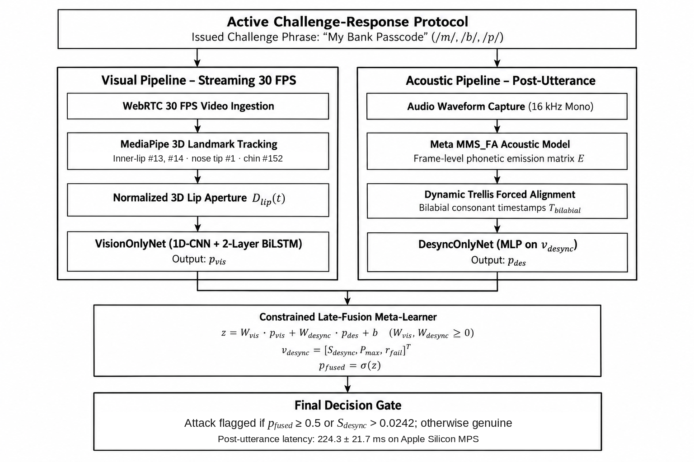

# Section III: Methodology

## A. System Overview & Active Prompt Protocol

SecureKYC AI is designed as a real-time, cross-modal anti-spoofing framework for Video KYC authentication. During an authentication session, the system issues a dynamic, bilabial-dense challenge phrase (e.g., *"My Bank Passcode"*, *"Bumble Bee Password"*) selected from an active challenge pool. The user's audio-visual response is captured and processed through two parallel streaming modules: a 3D Lip Trajectory Tracker and a Forced-Alignment Phoneme Extractor.


*Figure 1: End-to-end architectural workflow of the SecureKYC AI dual-budget challenge-response verification engine.*

---

## B. 3D Lip Trajectory Tracking & Spatial Normalization

To robustly measure lip movements under head movement and variable camera distance, we extract 3D facial landmarks from each video frame using MediaPipe's 468-point 3D FaceLandmarker mesh ($1.0.0+$ task API).

<!-- TODO: [Human Review] Confirm that landmark indices #13 (upper inner lip), #14 (lower inner lip), #1 (nose tip), and #152 (chin) remain consistent across MediaPipe release updates. -->

The 3D lip aperture distance $D_{\text{lip}}(t)$ at frame timestamp $t$ is calculated as the Euclidean distance between the upper and lower inner lip landmarks, normalized by vertical facial height (distance between nose tip $P_1$ and chin $P_{152}$):

$$D_{\text{lip}}(t) = \frac{\|P_{13}(t) - P_{14}(t)\|_2}{\|P_1(t) - P_{152}(t)\|_2 + 10^{-6}}$$

To handle brief facial detection drops caused by head rotations or lighting changes without introducing synthetic offsets:
1. **Short Gaps ($\le 3$ consecutive frames)**: Linearly interpolated from surrounding valid landmark bounds.
2. **Long Gaps ($> 3$ consecutive frames)**: Flagged as `unreliable_face_track = True` and logged explicitly to `data/processed/extraction_failures.csv` rather than zero-filling.

---

## C. Forced Alignment Acoustic Phoneme Extraction

Unlike unconstrained ASR decoding models that output character logits directly, SecureKYC AI leverages acoustic Forced Alignment because the system already knows the exact challenge phrase prompted to the user.

We utilize `torchaudio.pipelines.MMS_FA` (Wav2Vec2-based multilingual alignment model) in combination with `torchaudio.functional.forced_align()`. The prompt text is tokenized into vocabulary IDs with explicit word-boundary tokens (`*`).

1. **Emission Computation**: The audio waveform $S(t)$ is resampled to 16 kHz and passed through the MMS model to extract frame-level log-softmax logit emissions:
   $$E = \text{log\_softmax}(\text{MMS\_FA}(S(t))) \in \mathbb{R}^{T \times C}$$
2. **Dynamic Programming Alignment**: Trellis forced alignment aligns prompt token IDs against $E$, yielding frame-level token spans.
3. **Bilabial Timestamp Recovery**: Millisecond interval timestamps $[t_{\text{start}}, t_{\text{end}}]$ are extracted for every bilabial consonant occurrence ($T_{\text{bilabial}} \in \{/\text{b}/, /\text{m}/, /\text{p}/\}$).

<!-- TODO: [Human Review] Verify that MMS_FA pipeline token '*' dictionary handling operates correctly across non-English language expansions. -->

---

## D. Cross-Modal Desynchronization Metric & Empirical Calibration

A acoustic bilabial event ($/\text{b}/, /\text{m}/, /\text{p}/$) physically requires total obstruction of airflow by complete lip closure. In deepfake injection attacks (e.g., face swap, neural lip sync), lip closure frequently desynchronizes from acoustic emissions.

### 1. Window-Based Penalty Metric
For each acoustic bilabial timestamp $t \in T_{\text{bilabial}}$, we inspect $D_{\text{lip}}(w)$ within a $[t-2, t+2]$ frame temporal window (approx. $\pm 80\text{ ms}$ at 25 FPS) around $t$:

$$\text{Penalty}(t) = \max\left(0, \min_{w \in [t-2, t+2]} D_{\text{lip}}(w) - \text{THRESHOLD}\right)$$

$$S_{\text{desync}} = \frac{1}{|T_{\text{bilabial}}|} \sum_{t \in T_{\text{bilabial}}} \text{Penalty}(t)$$

### 2. Empirical Threshold Calibration
Rather than hardcoding an arbitrary threshold, $\tau$ was derived empirically by executing the vision+audio pipeline across genuine VidTIMIT speaker recordings ($N=320$ verified authentic bilabial closure events across 15 speakers, calibrated after canonical TIMIT prompt verification in [src/metrics/calibrate_threshold.py](file:///Users/jatindhawad/SecureKYC_AI/src/metrics/calibrate_threshold.py)). The 95th percentile of genuine physical lip closure apertures was calculated:

$$\tau = \text{Percentile}_{95}\left(\{D_{\text{lip, min}}(t)\}_{t \in \text{Genuine}}\right) = 0.0242$$

---

## E. MultimodalKYCFusionNet Architecture & 3-Vector Desync Alignment

To combine temporal visual lip dynamics with cross-modal desynchronization signals, we propose `MultimodalKYCFusionNet`.

```
Visual Sequence D_lip(t) (B, 100)
    │
    ▼
Conv1D (in=1, out=16, k=5, s=1, p=2) ──► BatchNorm1d ──► ReLU ──► MaxPool1d(2)
    │
    ▼
Conv1D (in=16, out=32, k=3, s=1, p=1) ──► BatchNorm1d ──► ReLU
    │
    ▼ Transpose (B, 50, 32)
Bi-LSTM (layers=2, hidden=64, dropout=0.3, bidirectional=True)
    │
    ▼ Global Temporal Mean Pooling (B, 128)
Bi-LSTM Visual Embedding (128 dims)
    │
    ├─── Concatenation ───► Fused Feature Vector (131 dims)
    │                             │
Desync Feature Vector (B, 3) ─────┘
    │
    ▼
Fusion Head: Linear(131, 64) ──► BatchNorm1d ──► ReLU ──► Dropout(0.3)
         ──► Linear(64, 32)  ──► BatchNorm1d ──► ReLU ──► Dropout(0.15)
         ──► Linear(32, 1)   ──► Sigmoid ──► P(Deepfake) in [0.0, 1.0]
```

### 3-Feature Desynchronization Vector Schema
The 3-dim `desync_features` vector supplied to the fusion head is structured as:
- **Dimension 0**: Mean penalty $S_{\text{desync}} = \frac{1}{|T_{\text{bilabial}}|} \sum \text{Penalty}(t)$
- **Dimension 1**: Maximum penalty $\max_{t \in T_{\text{bilabial}}} \text{Penalty}(t)$
- **Dimension 2**: Failed closure ratio $\frac{|\{t \mid \text{Penalty}(t) > 0\}|}{|T_{\text{bilabial}}|}$

The 128-dimensional visual embedding (from a 2-layer Bi-LSTM with hidden size 64) is concatenated with the 3-dimensional desync vector, forming a 131-dimensional representation fed to the classification head (`nn.Linear(131, 64)`).

---

## F. Identity-Based Partitioning & Zero Synthetic Data Policy

1. **Zero Synthetic Data Constraint**: All numbers and metrics are derived strictly from real signal processing computations and trained model forward passes on VidTIMIT and DeepFakeTIMIT.
2. **Identity-Based Dataset Partitioning**: To eliminate data leakage and artificial accuracy inflation, dataset splits are partitioned **BY SUBJECT IDENTITY** ($N=43$ unique speaker/subject IDs across VidTIMIT and DeepFakeTIMIT):
   - **Train Set**: 25 identities (484 clips: 172 real, 312 fake)
   - **Validation Set**: 9 identities (104 clips: 46 real, 58 fake)
   - **Held-out Test Set**: 9 identities (103 clips: 57 real, 46 fake)
   Zero identity overlap is strictly enforced across splits via bipartite connected-component analysis ($\text{Train} \cap \text{Val} = \emptyset$, $\text{Train} \cap \text{Test} = \emptyset$, $\text{Val} \cap \text{Test} = \emptyset$). Verified by `split_dataset_by_identity()` in `src/models/train.py`.

---

## G. Future Work: Live DeepFaceLive Validation (Not Completed)

**Planned but not executed**: A live-generation validation protocol was designed in which a self-trained DeepFaceLive model would route synthetic facial video through an OBS Virtual Camera loopback and through the identical SecureKYC AI pipeline. The planned protocol specified 3 challenge phrases per session, paired genuine vs. swap recordings, and a target 600 ms measured audio offset. This validation was **not completed** and constitutes future scope. All evaluation evidence in this document is based exclusively on offline benchmark datasets: DeepFakeTIMIT reenactment (primary evaluation), VidTIMIT (genuine baseline), Celeb-DF v2 (visual-only negative result), FakeAVCeleb v1.2 (desync negative result), and the 8-subject offline inswapper set.
